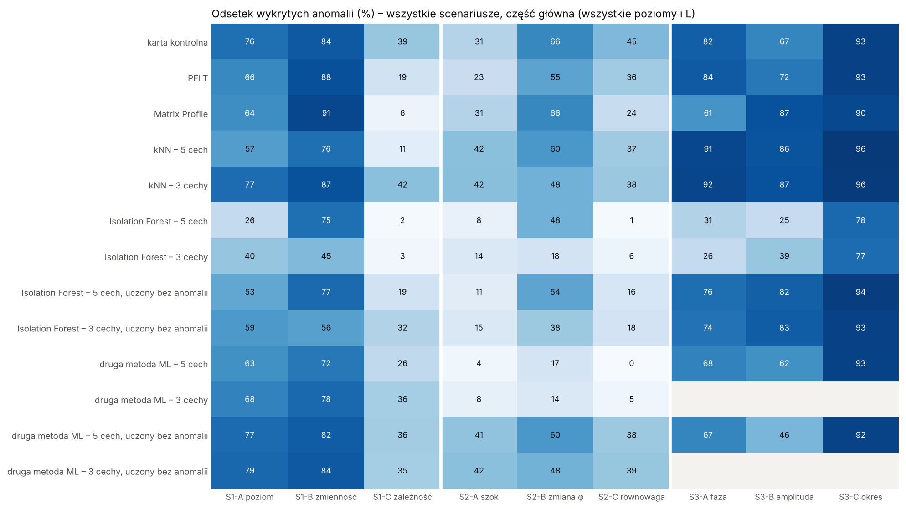
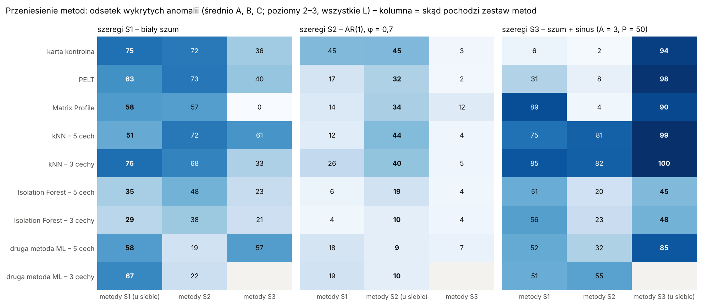
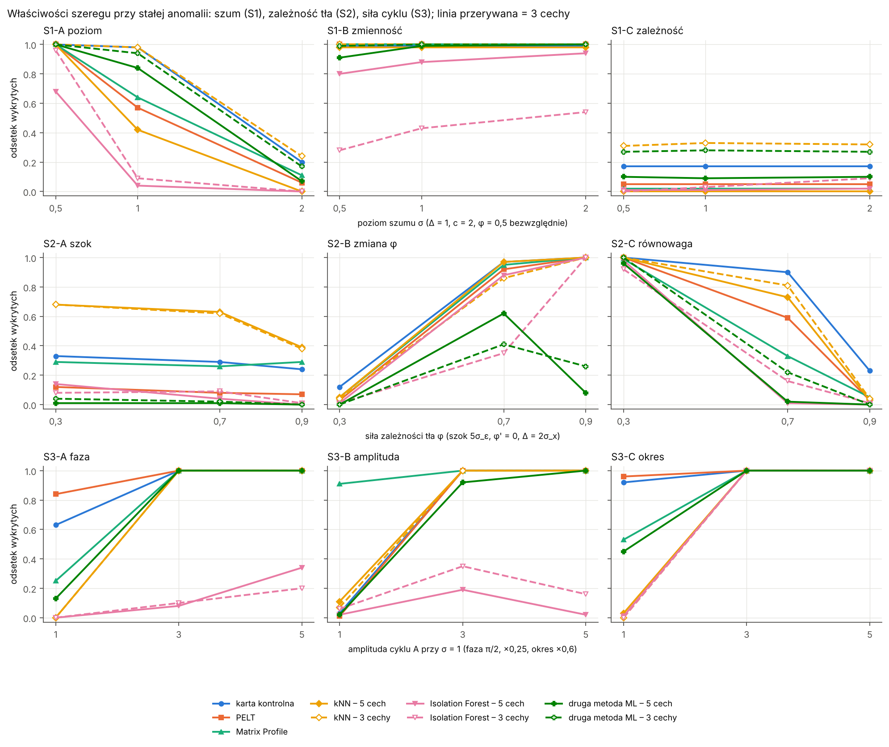
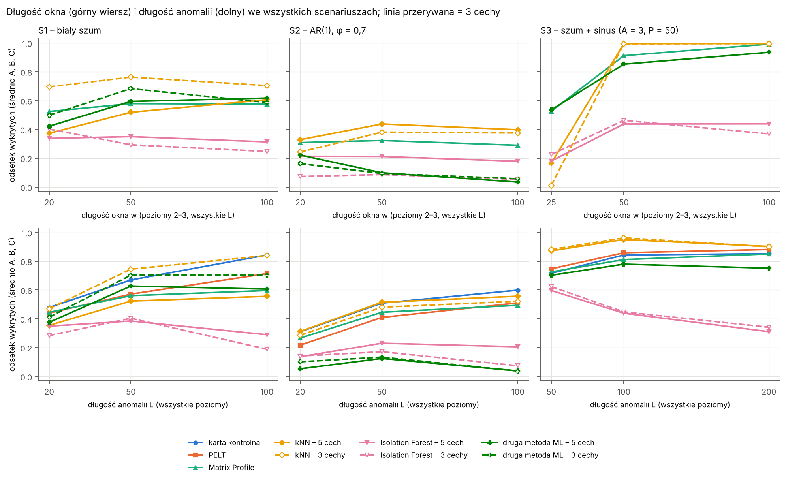

# Porównanie scenariuszy S1–S3: jak właściwości szeregu zmieniają skuteczność metod

> Stan na **2026-10-28**. Realizacja kroku 9 z [plan_etap_1.md](plan_etap_1.md), rozdz. 5 i 6 („które metody radzą
> sobie z anomaliami wartości, a które z anomaliami struktury, i jak zależność w szeregu zmienia ich skuteczność”).
> Podstawa: wyniki trzech scenariuszy po konsultacji 27.10 ([wyniki_s1.md](wyniki_s1.md), [wyniki_s2.md](wyniki_s2.md),
> [wyniki_s3.md](wyniki_s3.md)) oraz **nowy eksperyment przeniesienia metod** (rozdz. 5). Wszystkie liczby pochodzą
> z `wyniki/porownanie/podsumowanie.md` i plików CSV wyników (tabele generowane automatycznie); polecenia do
> odtworzenia – rozdz. 12.

## Spis treści

1. [Pytanie i sposób porównania](#1-pytanie-i-sposób-porównania)
2. [Najważniejsze wnioski](#2-najważniejsze-wnioski)
3. [Wyniki ogólne: która metoda w którym szeregu](#3-wyniki-ogólne-która-metoda-w-którym-szeregu)
4. [Rodzaje anomalii: wartości, struktury, dynamiki](#4-rodzaje-anomalii-wartości-struktury-dynamiki)
5. [Przeniesienie metod między scenariuszami](#5-przeniesienie-metod-między-scenariuszami)
6. [Właściwości szeregu przy stałej anomalii](#6-właściwości-szeregu-przy-stałej-anomalii)
7. [Ustawienia metod we wszystkich scenariuszach](#7-ustawienia-metod-we-wszystkich-scenariuszach)
8. [Fałszywe alarmy i dokładność lokalizacji](#8-fałszywe-alarmy-i-dokładność-lokalizacji)
9. [Jak dobrać metodę do szeregu – rekomendacje](#9-jak-dobrać-metodę-do-szeregu--rekomendacje)
10. [Weryfikacja oczekiwań z planu](#10-weryfikacja-oczekiwań-z-planu)
11. [Ograniczenia](#11-ograniczenia)
12. [Jak odtworzyć wyniki](#12-jak-odtworzyć-wyniki)

---

## 1. Pytanie i sposób porównania

**Pytanie z tematu pracy:** jak właściwości szeregu czasowego wpływają na skuteczność metod wykrywania anomalii
statystycznych i uczenia maszynowego. Trzy scenariusze etapu 1 różnią się właśnie właściwością szeregu tła:

| | Szereg tła | Właściwość | Anomalie A / B / C | Długości L |
|---|---|---|---|---|
| **S1** | biały szum, σ = 1 | brak zależności w czasie | zmiana poziomu / zmiana zmienności / pojawienie się zależności | 20, 50, 100 |
| **S2** | AR(1), φ = 0,7, σ_x = 1 | zależność – punkt zależy od poprzedniego | szok wygasający / zmiana siły zależności φ / przesunięcie poziomu równowagi | 20, 50, 100 (szok: 10) |
| **S3** | sinus (A = 3, P = 50) + szum σ = 1 | okresowość – deterministyczny cykl | przesunięcie fazy / zmiana amplitudy / zmiana okresu | 50, 100, 200 (1–4 cykle) |

W każdym scenariuszu: 1 200 szeregów w części głównej (4 poziomy intensywności × 3 długości × 100 szeregów, w każdym
szeregu wszystkie trzy anomalie), ta sama ocena i ten sam próg (fałszywy alarm w 10% szeregów bez anomalii).

**Metody porównujemy w rodzinach** – ta sama rola w każdym scenariuszu, konfiguracja dopasowana do szeregu
(plan, rozdz. 4.2):

| rodzina | S1 | S2 | S3 |
|---|---|---|---|
| karta kontrolna | CUSUM (poziom, zmienność, zależność) | reszty AR + CUSUM | STL + EWMA |
| PELT | PELT | PELT (koszt AR) | PELT (reszty STL) |
| Matrix Profile | Matrix Profile | Matrix Profile (reszty AR) | Matrix Profile z normalizacją |
| kNN | cechy okien + kNN | cechy okien + kNN | cechy cykli + kNN |
| Isolation Forest | Isolation Forest | Isolation Forest | Isolation Forest |
| druga metoda ML | LOF | One-Class SVM | autoenkoder |

Metody na cechach okien (kNN, Isolation Forest, LOF, One-Class SVM) mają warianty **5 i 3 cech**, a metody ML –
także **uczone na 20 szeregach bez anomalii** (ustalenia z konsultacji 27.10). Autoenkoder (S3) nie używa cech –
ma tylko wariant uczony na tym samym szeregu i na szeregach bez anomalii; w tabelach zbiorczych jego wyniki są
w wierszach „druga metoda ML – 5 cech”.

**Jak porównywać uczciwie.** Anomalie i ich poziomy intensywności dobrano osobno dla każdego scenariusza, więc sam
odsetek wykrytych z różnych scenariuszy nie mówi, „który szereg jest trudniejszy” – zależy też od tego, jak silne
anomalie wybraliśmy. Dlatego porównanie opiera się na czterech rzeczach, które nie zależą od tej skali:
1. **kolejność rodzin metod** w każdym scenariuszu i to, które rodziny wygrywają z jakim rodzajem anomalii (rozdz. 3–4),
2. **przeniesienie metod** – nowy eksperyment: metody dopasowane do jednego scenariusza uruchomione na szeregach
   drugiego, na tych samych anomaliach (rozdz. 5) – mierzy, ile skuteczności daje dopasowanie metody do szeregu,
3. **właściwość szeregu zmieniana przy stałej anomalii** – części „szum” (S1), „tło” (S2, S3) z eksperymentów
   scenariuszy (rozdz. 6),
4. **ustawienia metod** (zestaw cech, sposób uczenia, okno) i to, czy ich najlepszy wybór jest taki sam we
   wszystkich szeregach (rozdz. 7).

---

## 2. Najważniejsze wnioski

1. **Nie ma jednej najlepszej metody dla wszystkich szeregów.** Najlepsze w scenariuszu: S1 – kNN na 3 cechach (69% wykrytych średnio; CUSUM 66%), S2 – reszty AR + CUSUM (47%), S3 – kNN na cechach cykli (91%). Kolejność pozostałych rodzin też zmienia się z szeregiem.
2. **Najbardziej uniwersalna jest rodzina cech okien + kNN** – w czołówce każdego scenariusza, o ile cechy opisują właściwość szeregu zaburzaną przez anomalię (S1: 77 / 87 / 42% na 3 cechach, S2: 42 / 60 / 37% na 5 cechach, S3: 92 / 87 / 96% na cechach cykli) i okno obejmuje skalę struktury szeregu (w S3 – cały cykl).
3. **O skuteczności decyduje, czy model normy metody obejmuje strukturę szeregu** (eksperyment przeniesienia). Model ogólniejszy niż szereg nic nie kosztuje (reszty AR + CUSUM na białym szumie: 88 / 95 / 32% wobec 92 / 95 / 38% CUSUM). Brak modelu cyklu wyłącza statystyki liczone z surowych wartości (CUSUM z S1 na szeregu okresowym: 4 / 0 / 14%). **Zły model tła jest gorszy niż brak modelu**: na szeregu okresowym metody bez modelu wykrywają średnio 55%, metody z modelem AR – 34%; na szeregu AR metody bez modelu 18%, metody z modelem cyklu – 5%.
4. **Zależność w czasie utrudnia wykrywanie najbardziej.** W S2 najwyższe średnie AUC rodziny to 0,85 (S1: 0,93, S3: 0,99); przy tym samym przesunięciu równowagi (Δ = 2σ_x) karta kontrolna wykrywa 100% / 90% / 23% anomalii przy φ tła = 0,3 / 0,7 / 0,9 – silna zależność sama wytwarza „wędrówki” poziomu podobne do anomalii.
5. **Okresowość pomaga, o ile cykl jest wyraźny**: przy amplitudzie 3σ i 5σ anomalie cyklu wykrywa prawie każda metoda (poza Isolation Forest uczonym na tym samym szeregu); przy amplitudzie równej szumowi cechy cyklu z pojedynczego okna zawodzą (kNN 0 / 11 / 3%), a model cyklu z całego szeregu działa dalej (PELT na resztach STL 84 / 1 / 96%) – kolejność metod się odwraca.
6. **Szum liczy się względem wielkości anomalii**: to samo przesunięcie poziomu (Δ = 1) przy σ = 0,5 i σ = 2 – karta 100% i 20%; anomalie względne (zmienność, zależność) od szumu nie zależą. Tak samo zależność tła: ta sama zmiana φ → 0 jest łatwiejsza przy silnej zależności tła (karta, φ tła 0,3 → 0,9: 12% → 100%).
7. **Anomalie wartości są najłatwiejsze, anomalie wynikające z dynamiki tła – najtrudniejsze**: najlepsza rodzina wykrywa średnio 84% anomalii wartości, 72% struktury i 41% dynamiki. Metody statystyczne nadążają za najlepszymi przy anomaliach wartości; przy anomaliach struktury wygrywają cechy okien i reszty modelu tła.
8. **Ustawienia metod też zależą od szeregu**: lepszy zestaw cech – 3 w S1, 5 w S2, bez różnicy w S3; okno – w S3 co najmniej jeden cykl (kNN przy pół cyklu: 17%). **Niezależne od szeregu**: Isolation Forest uczony na tym samym szeregu maskuje długie anomalie (wysokie AUC, niskie wykrywanie), uczenie na szeregach bez anomalii to poprawia (S3: 31 / 25 / 78% → 76 / 82 / 94%); wspólny próg trzyma 10% fałszywych alarmów we wszystkich szeregach (5,7–15,7% / 4,0–12,3% / 7,2–13,1% na 1 000 szeregach).

---

## 3. Wyniki ogólne: która metoda w którym szeregu



**Odsetek wykrytych anomalii (%)**, część główna (wszystkie poziomy i długości L; 1 200 anomalii każdego rodzaju):

| metoda | S1-A poziom | S1-B zmienność | S1-C zależność | S2-A szok | S2-B zmiana φ | S2-C równowaga | S3-A faza | S3-B amplituda | S3-C okres |
|---|---|---|---|---|---|---|---|---|---|
| karta kontrolna | 76 | 84 | 39 | 31 | 66 | 45 | 82 | 67 | 93 |
| PELT | 66 | 88 | 19 | 23 | 55 | 36 | 84 | 72 | 93 |
| Matrix Profile | 64 | 91 | 6 | 31 | 66 | 24 | 61 | 87 | 90 |
| kNN – 5 cech | 57 | 76 | 11 | 42 | 60 | 37 | 91 | 86 | 96 |
| kNN – 3 cechy | 77 | 87 | 42 | 42 | 48 | 38 | 92 | 87 | 96 |
| Isolation Forest – 5 cech | 26 | 75 | 2 | 8 | 48 | 1 | 31 | 25 | 78 |
| Isolation Forest – 3 cechy | 40 | 45 | 3 | 14 | 18 | 6 | 26 | 39 | 77 |
| Isolation Forest – 5 cech, uczony bez anomalii | 53 | 77 | 19 | 11 | 54 | 16 | 76 | 82 | 94 |
| Isolation Forest – 3 cechy, uczony bez anomalii | 59 | 56 | 32 | 15 | 38 | 18 | 74 | 83 | 93 |
| druga metoda ML – 5 cech | 63 | 72 | 26 | 4 | 17 | 0 | 68 | 62 | 93 |
| druga metoda ML – 3 cechy | 68 | 78 | 36 | 8 | 14 | 5 | – | – | – |
| druga metoda ML – 5 cech, uczony bez anomalii | 77 | 82 | 36 | 41 | 60 | 38 | 67 | 46 | 92 |
| druga metoda ML – 3 cechy, uczony bez anomalii | 79 | 84 | 35 | 42 | 48 | 39 | – | – | – |

**AUC** (miara niezależna od progu):

| metoda | S1-A poziom | S1-B zmienność | S1-C zależność | S2-A szok | S2-B zmiana φ | S2-C równowaga | S3-A faza | S3-B amplituda | S3-C okres |
|---|---|---|---|---|---|---|---|---|---|
| karta kontrolna | 0,90 | 0,92 | 0,88 | 0,61 | 0,79 | 0,82 | 0,95 | 0,89 | 0,93 |
| PELT | 0,81 | 0,90 | 0,55 | 0,56 | 0,75 | 0,66 | 0,86 | 0,79 | 0,85 |
| Matrix Profile | 0,90 | 0,99 | 0,46 | 0,80 | 0,92 | 0,75 | 0,68 | 0,96 | 0,88 |
| kNN – 5 cech | 0,94 | 0,97 | 0,83 | 0,81 | 0,91 | 0,82 | 0,99 | 0,98 | 0,99 |
| kNN – 3 cechy | 0,95 | 0,98 | 0,85 | 0,81 | 0,87 | 0,83 | 0,99 | 0,98 | 0,99 |
| Isolation Forest – 5 cech | 0,94 | 0,98 | 0,84 | 0,80 | 0,90 | 0,82 | 0,99 | 0,98 | 0,99 |
| Isolation Forest – 3 cechy | 0,95 | 0,98 | 0,86 | 0,81 | 0,86 | 0,84 | 0,99 | 0,98 | 0,99 |
| Isolation Forest – 5 cech, uczony bez anomalii | 0,93 | 0,98 | 0,83 | 0,80 | 0,90 | 0,82 | 0,99 | 0,98 | 0,99 |
| Isolation Forest – 3 cechy, uczony bez anomalii | 0,96 | 0,97 | 0,86 | 0,80 | 0,86 | 0,84 | 0,99 | 0,98 | 0,99 |
| druga metoda ML – 5 cech | 0,92 | 0,91 | 0,81 | 0,75 | 0,81 | 0,80 | 0,71 | 0,72 | 0,93 |
| druga metoda ML – 3 cechy | 0,92 | 0,93 | 0,82 | 0,74 | 0,71 | 0,80 | – | – | – |
| druga metoda ML – 5 cech, uczony bez anomalii | 0,95 | 0,96 | 0,82 | 0,78 | 0,88 | 0,85 | 0,71 | 0,67 | 0,93 |
| druga metoda ML – 3 cechy, uczony bez anomalii | 0,95 | 0,97 | 0,83 | 0,77 | 0,80 | 0,85 | – | – | – |

**Najlepsze metody w każdym scenariuszu** (średnio A, B, C):

| scenariusz | miejsce | metoda | wykryte (średnio A, B, C) | AUC (średnio) |
|---|---|---|---|---|
| S1 | 1 | cechy okien + kNN (3 cechy) | 69% | 0,93 |
|  | 2 | CUSUM (poziom, zmienność, zależność) | 66% | 0,90 |
|  | 3 | LOF (3 cechy, uczony na szeregach bez anomalii) | 66% | 0,92 |
|  | 4 | LOF (5 cech, uczony na szeregach bez anomalii) | 65% | 0,91 |
| S2 | 1 | reszty AR + CUSUM | 47% | 0,74 |
|  | 2 | cechy okien + kNN (5 cech) | 46% | 0,85 |
|  | 3 | One-Class SVM (5 cech, uczony na szeregach bez anomalii) | 46% | 0,84 |
|  | 4 | One-Class SVM (3 cechy, uczony na szeregach bez anomalii) | 43% | 0,81 |
| S3 | 1 | cechy cykli + kNN (3 cechy) | 91% | 0,99 |
|  | 2 | cechy cykli + kNN (5 cech) | 91% | 0,99 |
|  | 3 | Isolation Forest (5 cech, uczony na szeregach bez anomalii) | 84% | 0,99 |
|  | 4 | Isolation Forest (3 cechy, uczony na szeregach bez anomalii) | 83% | 0,99 |

- **S1 – biały szum:** kNN na 3 cechach i CUSUM praktycznie na równi (69% i 66%);
  obok nich LOF uczony na szeregach bez anomalii (66%). Bez zależności w tle każda dobrze
  dobrana statystyka (średnia, wariancja, autokorelacja) wystarcza.
- **S2 – AR(1):** wszystkie metody wyraźnie słabsze; czołówka to reszty AR + CUSUM (47%), kNN na
  5 cechach (46%) i One-Class SVM uczony na szeregach bez anomalii (46%) – rodziny
  różne, wynik podobny. Najwyższe średnie AUC metody to 0,85 wobec
  0,93 w S1 i 0,99 w S3.
- **S3 – szereg okresowy:** wyraźna przewaga cech cykli + kNN (91%, AUC 0,99);
  za nim Isolation Forest uczony na szeregach bez anomalii (84%) i metody na resztach STL
  (PELT 83%, STL + EWMA 80%).
- **We wszystkich trzech** Isolation Forest uczony na tym samym szeregu ma wysokie AUC
  (0,92 / 0,84 / 0,98), ale wykrywa mało (34% /
  19% / 45%) – maskowanie: długa anomalia „uczy” las, że jest normalna, a maksimum
  wyniku na szeregu bez anomalii (próg) jest wysokie.

---

## 4. Rodzaje anomalii: wartości, struktury, dynamiki

Dziewięć anomalii dzieli się na trzy grupy według tego, **co zmienia się we fragmencie** (plan, rozdz. 3):

- **anomalie wartości – zmienia się poziom albo rozrzut:** S1-A, S1-B, S3-B (osłabienie cyklu zmniejsza wariancję fragmentu z 5,5 do 1 + 4,5k²),
- **anomalie struktury – średnia i wariancja jak w normie, zmienia się przebieg w czasie:** S1-C, S2-B, S3-A, S3-C,
- **anomalie o kształcie wynikającym z dynamiki tła – bez ostrej granicy:** S2-A (szok wygasa w tempie φ), S2-C (szereg dochodzi do nowego poziomu stopniowo).

**Najlepsza metoda w każdej grupie metod** (wszystkie poziomy i L):

| kategoria | anomalia | najlepsza statystyczna | najlepsza „fragmenty” | najlepsza ML |
|---|---|---|---|---|
| wartości | S1-A poziom | CUSUM (poziom, zmienność, zależność) – **76%** | cechy okien + kNN (3 cechy) – **77%** | LOF (3 cechy, uczony na szeregach bez anomalii) – **79%** |
| wartości | S1-B zmienność | PELT – **88%** | Matrix Profile – **91%** | LOF (3 cechy, uczony na szeregach bez anomalii) – **84%** |
| wartości | S3-B amplituda | PELT (reszty STL) – **72%** | Matrix Profile z normalizacją – **87%** | Isolation Forest (3 cechy, uczony na szeregach bez anomalii) – **83%** |
| struktury | S1-C zależność | CUSUM (poziom, zmienność, zależność) – **39%** | cechy okien + kNN (3 cechy) – **42%** | LOF (5 cech, uczony na szeregach bez anomalii) – **36%** |
| struktury | S2-B zmiana φ | reszty AR + CUSUM – **66%** | Matrix Profile (reszty AR) – **66%** | One-Class SVM (5 cech, uczony na szeregach bez anomalii) – **60%** |
| struktury | S3-A faza | PELT (reszty STL) – **84%** | cechy cykli + kNN (3 cechy) – **92%** | Isolation Forest (5 cech, uczony na szeregach bez anomalii) – **76%** |
| struktury | S3-C okres | PELT (reszty STL) – **93%** | cechy cykli + kNN (5 cech) – **96%** | Isolation Forest (5 cech, uczony na szeregach bez anomalii) – **94%** |
| dynamiki | S2-A szok | reszty AR + CUSUM – **31%** | cechy okien + kNN (3 cechy) – **42%** | One-Class SVM (3 cechy, uczony na szeregach bez anomalii) – **42%** |
| dynamiki | S2-C równowaga | reszty AR + CUSUM – **45%** | cechy okien + kNN (3 cechy) – **38%** | One-Class SVM (3 cechy, uczony na szeregach bez anomalii) – **39%** |

**Średnio w kategorii** (dla każdej rodziny jej najlepszy wariant):

| kategoria | karta kontrolna | PELT | Matrix Profile | kNN | Isolation Forest | druga metoda ML |
|---|---|---|---|---|---|---|
| wartości | 76% | 75% | 81% | 84% | 73% | 75% |
| struktury | 70% | 63% | 56% | 72% | 64% | 64% |
| dynamiki | 38% | 30% | 27% | 40% | 16% | 41% |

- **Anomalie wartości** – wszystkie rodziny radzą sobie podobnie (73–84%);
  prosta statystyka (karta kontrolna, PELT) wystarcza i wskazuje dobrze zasięg anomalii.
- **Anomalie struktury** – przewaga metod, które **opisują strukturę wprost**: cech okien (autokorelacja, faza,
  częstotliwość) albo reszt modelu tła (karta i PELT na resztach). Matrix Profile jest tu najsłabszy
  (56%): porównuje kształt fragmentów, a fragment „gładszy” niż reszta szeregu (S1-C) ma
  bliskiego sąsiada w normie.
- **Anomalie dynamiki** – najtrudniejsze dla wszystkich (najwyżej 41%); bez ostrej granicy
  i z kształtem takim, jaki ma naturalne odchylenie szeregu AR. Isolation Forest prawie ich nie wykrywa
  (16%).

---

## 5. Przeniesienie metod między scenariuszami

**Nowy eksperyment** (`src/ewaluacja/porownanie.py`). Zestaw metod skonfigurowany dla scenariusza X uruchamiamy na
szeregach scenariusza Y – macierz 3 × 3:
- na przekątnej – metody „u siebie” (wyniki części głównej),
- poza przekątną – metody S1 (bez modelu tła) na szeregu zależnym i okresowym, metody S2 (reszty modelu AR(1),
  cechy dynamiki AR) na białym szumie i szeregu okresowym, metody S3 (reszty STL, cechy cykli, okno = okres) na białym
  szumie i szeregu AR.

**Procedura jak w scenariuszach:** stałe metod i progi kalibrowane na 200 szeregach bez anomalii **scenariusza
docelowego** (fałszywy alarm w 10%), walidacja na 200 nowych. Ocena na **tych samych szeregach co w części głównej**
scenariusza docelowego (te same ziarna): poziomy intensywności 2 i 3, wszystkie L, 50 szeregów na (poziom, L) – 300
szeregów i 900 anomalii na komórkę. Przekątna to te same 300 szeregów z części głównej, więc porównanie jest
sparowane. Kontrola: silnik porównania odtwarza wyniki części głównej co do bitu (sprawdzone na 12 szeregach każdego
scenariusza), a metody S1 na S2 dają to samo co analiza dodatkowa (a) w S2 na innych szeregach (CUSUM z S1 przy
L = 50, A / B / C: 37 / 54 / 53% w przeniesieniu wobec 34 / 57 / 56% w analizie (a)).



**Średnio dla wszystkich wariantów metod** (A, B, C łącznie) i najlepszy wariant w komórce:

| szeregi | metody S1 | metody S2 | metody S3 |
|---|---|---|---|
| S1 – biały szum | **57% (najlepsza: cechy okien + kNN (3 cechy) – 76%)** | 52% (najlepsza: PELT (koszt AR) – 73%) | 34% (najlepsza: cechy cykli + kNN (5 cech) – 61%) |
| S2 – AR(1), φ = 0,7 | 18% (najlepsza: CUSUM (poziom, zmienność, zależność) – 45%) | **27% (najlepsza: reszty AR + CUSUM – 45%)** | 5% (najlepsza: Matrix Profile z normalizacją – 12%) |
| S3 – szum + sinus (A = 3, P = 50) | 55% (najlepsza: Matrix Profile – 89%) | 34% (najlepsza: cechy okien + kNN (3 cechy) – 82%) | **82% (najlepsza: cechy cykli + kNN (3 cechy) – 100%)** |

**Odsetek wykrytych A / B / C** – osobno dla szeregów każdego scenariusza (pogrubione – metody u siebie):

**Szeregi S1 – biały szum:**

| metoda | metody S1 (u siebie) | metody S2 | metody S3 |
|---|---|---|---|
| karta kontrolna | **92 / 95 / 38%** | 88 / 95 / 32% | 12 / 96 / 1% |
| PELT | **79 / 97 / 13%** | 86 / 93 / 39% | 17 / 94 / 8% |
| Matrix Profile | **74 / 97 / 4%** | 71 / 97 / 2% | 0 / 0 / 0% |
| kNN – 5 cech | **64 / 90 / 1%** | 87 / 95 / 35% | 69 / 94 / 19% |
| kNN – 3 cechy | **89 / 96 / 43%** | 87 / 87 / 29% | 59 / 35 / 4% |
| Isolation Forest – 5 cech | **17 / 87 / 0%** | 46 / 89 / 8% | 33 / 34 / 3% |
| Isolation Forest – 3 cechy | **39 / 47 / 0%** | 55 / 56 / 2% | 48 / 14 / 1% |
| druga metoda ML – 5 cech | **75 / 81 / 18%** | 20 / 38 / 0% | 71 / 97 / 3% |
| druga metoda ML – 3 cechy | **80 / 88 / 31%** | 45 / 19 / 1% | – |

**Szeregi S2 – AR(1), φ = 0,7:**

| metoda | metody S1 | metody S2 (u siebie) | metody S3 |
|---|---|---|---|
| karta kontrolna | 34 / 51 / 49% | **13 / 73 / 50%** | 4 / 0 / 6% |
| PELT | 5 / 7 / 40% | **3 / 61 / 33%** | 2 / 2 / 4% |
| Matrix Profile | 1 / 0 / 41% | **15 / 74 / 13%** | 0 / 37 / 0% |
| kNN – 5 cech | 12 / 10 / 14% | **34 / 65 / 32%** | 0 / 0 / 12% |
| kNN – 3 cechy | 0 / 36 / 42% | **35 / 50 / 36%** | 0 / 0 / 14% |
| Isolation Forest – 5 cech | 3 / 0 / 15% | **3 / 55 / 1%** | 0 / 0 / 12% |
| Isolation Forest – 3 cechy | 0 / 0 / 11% | **7 / 19 / 4%** | 0 / 0 / 13% |
| druga metoda ML – 5 cech | 8 / 19 / 27% | **4 / 24 / 0%** | 1 / 1 / 18% |
| druga metoda ML – 3 cechy | 0 / 24 / 33% | **8 / 18 / 4%** | – |

**Szeregi S3 – szum + sinus (A = 3, P = 50):**

| metoda | metody S1 | metody S2 | metody S3 (u siebie) |
|---|---|---|---|
| karta kontrolna | 4 / 0 / 14% | 1 / 1 / 3% | **99 / 83 / 100%** |
| PELT | 1 / 93 / 0% | 0 / 23 / 1% | **100 / 94 / 100%** |
| Matrix Profile | 79 / 86 / 100% | 3 / 1 / 8% | **72 / 100 / 100%** |
| kNN – 5 cech | 52 / 98 / 75% | 58 / 98 / 88% | **100 / 98 / 100%** |
| kNN – 3 cechy | 66 / 98 / 92% | 62 / 92 / 90% | **100 / 99 / 100%** |
| Isolation Forest – 5 cech | 21 / 96 / 36% | 5 / 39 / 17% | **20 / 14 / 100%** |
| Isolation Forest – 3 cechy | 35 / 83 / 51% | 18 / 6 / 44% | **19 / 28 / 97%** |
| druga metoda ML – 5 cech | 37 / 77 / 41% | 13 / 42 / 42% | **81 / 73 / 100%** |
| druga metoda ML – 3 cechy | 33 / 74 / 45% | 39 / 61 / 66% | – |


**AUC A / B / C:**

**Szeregi S1 – biały szum:**

| metoda | metody S1 (u siebie) | metody S2 | metody S3 |
|---|---|---|---|
| karta kontrolna | **0,98 / 0,96 / 0,92** | 0,99 / 0,97 / 0,91 | 0,71 / 0,97 / 0,37 |
| PELT | **0,87 / 0,95 / 0,52** | 0,91 / 0,94 / 0,67 | 0,56 / 0,94 / 0,51 |
| Matrix Profile | **0,95 / 1,00 / 0,47** | 0,95 / 1,00 / 0,44 | 0,47 / 0,50 / 0,45 |
| kNN – 5 cech | **0,99 / 1,00 / 0,85** | 0,99 / 1,00 / 0,85 | 0,83 / 1,00 / 0,72 |
| kNN – 3 cechy | **0,99 / 1,00 / 0,88** | 0,99 / 0,98 / 0,86 | 0,82 / 0,80 / 0,69 |
| Isolation Forest – 5 cech | **0,98 / 1,00 / 0,87** | 0,99 / 1,00 / 0,87 | 0,83 / 0,99 / 0,70 |
| Isolation Forest – 3 cechy | **0,99 / 1,00 / 0,88** | 0,99 / 0,98 / 0,87 | 0,82 / 0,77 / 0,64 |
| druga metoda ML – 5 cech | **0,97 / 0,95 / 0,84** | 0,93 / 0,97 / 0,77 | 0,88 / 0,98 / 0,46 |
| druga metoda ML – 3 cechy | **0,97 / 0,97 / 0,84** | 0,94 / 0,89 / 0,78 | – |

**Szeregi S2 – AR(1), φ = 0,7:**

| metoda | metody S1 | metody S2 (u siebie) | metody S3 |
|---|---|---|---|
| karta kontrolna | 0,54 / 0,53 / 0,82 | **0,61 / 0,86 / 0,87** | 0,67 / 0,64 / 0,63 |
| PELT | 0,49 / 0,51 / 0,67 | **0,50 / 0,77 / 0,64** | 0,50 / 0,50 / 0,51 |
| Matrix Profile | 0,74 / 0,77 / 0,85 | **0,81 / 0,95 / 0,74** | 0,49 / 0,86 / 0,34 |
| kNN – 5 cech | 0,74 / 0,90 / 0,88 | **0,82 / 0,95 / 0,86** | 0,62 / 0,55 / 0,65 |
| kNN – 3 cechy | 0,67 / 0,92 / 0,89 | **0,83 / 0,91 / 0,88** | 0,53 / 0,54 / 0,62 |
| Isolation Forest – 5 cech | 0,72 / 0,83 / 0,86 | **0,81 / 0,95 / 0,86** | 0,60 / 0,51 / 0,65 |
| Isolation Forest – 3 cechy | 0,64 / 0,89 / 0,90 | **0,82 / 0,91 / 0,89** | 0,52 / 0,55 / 0,63 |
| druga metoda ML – 5 cech | 0,68 / 0,90 / 0,86 | **0,73 / 0,86 / 0,84** | 0,74 / 0,68 / 0,67 |
| druga metoda ML – 3 cechy | 0,64 / 0,90 / 0,86 | **0,73 / 0,76 / 0,84** | – |

**Szeregi S3 – szum + sinus (A = 3, P = 50):**

| metoda | metody S1 | metody S2 | metody S3 (u siebie) |
|---|---|---|---|
| karta kontrolna | 0,52 / 0,50 / 0,51 | 0,53 / 0,27 / 0,47 | **0,98 / 0,94 / 0,96** |
| PELT | 0,50 / 0,95 / 0,50 | 0,50 / 0,61 / 0,50 | **0,95 / 0,86 / 0,90** |
| Matrix Profile | 0,73 / 0,92 / 0,95 | 0,58 / 0,52 / 0,70 | **0,71 / 1,00 / 0,95** |
| kNN – 5 cech | 0,69 / 1,00 / 0,89 | 0,70 / 1,00 / 0,90 | **1,00 / 1,00 / 1,00** |
| kNN – 3 cechy | 0,70 / 1,00 / 0,91 | 0,70 / 0,99 / 0,90 | **1,00 / 1,00 / 1,00** |
| Isolation Forest – 5 cech | 0,69 / 1,00 / 0,84 | 0,68 / 0,99 / 0,84 | **1,00 / 1,00 / 1,00** |
| Isolation Forest – 3 cechy | 0,70 / 1,00 / 0,89 | 0,69 / 0,98 / 0,88 | **1,00 / 1,00 / 1,00** |
| druga metoda ML – 5 cech | 0,69 / 0,84 / 0,87 | 0,63 / 0,90 / 0,73 | **0,75 / 0,76 / 1,00** |
| druga metoda ML – 3 cechy | 0,69 / 0,84 / 0,87 | 0,63 / 0,85 / 0,77 | – |


- **Na każdym szeregu najlepiej wypadają metody „u siebie”** (średnio 57% / 27% / 82% w S1 / S2 / S3), a **metody z niewłaściwym modelem tła – najgorzej**: na szeregu okresowym metody S1 (bez modelu) 55%, metody S2 (model AR) 34%; na szeregu AR metody S1 18%, metody S3 (model cyklu) 5%. **Zły model tła jest gorszy niż brak modelu.**
- **Model ogólniejszy niż szereg nic nie kosztuje (S2 → S1).** AR(1) z φ ≈ 0 to biały szum, więc reszty modelu to prawie sam szereg: reszty AR + CUSUM 88 / 95 / 32% wobec CUSUM 92 / 95 / 38%, PELT z kosztem AR lepiej wykrywa zależność (39% wobec 13%), a kNN na cechach S2 (5 cech) – 87 / 95 / 35% wobec 64 / 90 / 1% na 5 cechach S1. Niższa średnia całego zestawu (52% wobec 57%) wynika tylko z One-Class SVM uczonego na tym samym szeregu (20 / 38 / 0% wobec LOF 75 / 81 / 18%) – z wyboru metody ML, nie z modelu AR.
- **Brak modelu zależności (S1 → S2) – strata dla metod okienkowych.** Karta kontrolna bez modelu AR wykrywa średnio tyle samo co na resztach AR (34 / 51 / 49% wobec 13 / 73 / 50%), ale inne anomalie: lepiej szok (model AR „przenosi” go na jeden punkt reszt), gorzej zmianę φ. Cechy z S1 nie opisują dynamiki AR – kNN na 5 cechach S1 12 / 10 / 14% wobec 34 / 65 / 32% na cechach S2; Matrix Profile bez modelu 1 / 0 / 41% wobec 15 / 74 / 13% na resztach AR.
- **Brak modelu cyklu (S1 → S3) wyłącza statystyki z surowych wartości.** CUSUM 4 / 0 / 14% (AUC 0,51 – zgadywanie), PELT 1 / 93 / 0%: cykl o amplitudzie 3σ dominuje średnią, wariancję i autokorelację, a próg ustawiony na jego zmienność jest za wysoki. **Metody okienkowe z oknem = jeden cykl działają nadal** (kNN na 3 cechach S1: 66 / 98 / 92%, Matrix Profile bez normalizacji: 79 / 86 / 100%) – okno pełnego cyklu „uśrednia” cykl, a anomalia zmienia jego statystyki.
- **Niewłaściwy model tła (S2 → S3, S3 → S2) – największa strata.** AR(1) nie opisuje cyklu: reszty zachowują cykl i metody na resztach zawodzą (reszty AR + CUSUM 1 / 1 / 3%, PELT 0 / 23 / 1%, Matrix Profile na resztach 3 / 1 / 8% wobec 79 / 86 / 100% bez modelu). Odwrotnie STL z okresem 50 na szeregu AR: trend STL wchłania wolne zmiany poziomu (na przykładowym szeregu średnia fragmentu przesunięcia równowagi 1,88 → 0,20 w resztach), a reszty pozostają zależne (autokorelacja 0,66) – metody S3 wykrywają na szeregu AR średnio 5% (karta EWMA 4 / 0 / 6%). Cechy okien bez modelu tła (kNN na cechach S2 w S3: 62 / 92 / 90%) nadal działają.
- **Model cyklu na białym szumie (S3 → S1)**: reszty STL to prawie cały szereg, więc karta energii reszt widzi zmienność (96%), ale nie poziom (12%); cechy fazy i częstotliwości szumu są przypadkowe – pojawienia się zależności nie wykrywa żadna metoda S3 (najwyżej 19%).
- **Wniosek:** o skuteczności decyduje to, czy **model normy metody obejmuje strukturę szeregu** – model ogólniejszy niż szereg nic nie kosztuje, model uboższy traci tam, gdzie struktura szeregu przypomina anomalię, a model niewłaściwy jest najgorszy. Najodporniejsze na niedopasowanie są **metody okienkowe z oknem obejmującym skalę struktury szeregu** (tu – jeden cykl): w 4 z 6 komórek poza przekątną najlepsza jest metoda okienkowa (kNN albo Matrix Profile).

---

## 6. Właściwości szeregu przy stałej anomalii

W każdym scenariuszu jedna część eksperymentu zmienia **tylko właściwość tła**, przy tej samej anomalii:
S1 – poziom szumu σ przy stałej bezwzględnej wielkości anomalii (Δ = 1, c = 2, φ = 0,5; L = 50), S2 – siła zależności
tła φ (szok 5σ_ε, φ' = 0, Δ = 2σ_x; L = 50), S3 – amplituda cyklu A przy szumie σ = 1 (faza +π/2, amplituda ×0,25,
okres ×0,6; L = 100). 100 szeregów na wartość; próg kalibrowany osobno dla każdego tła.



**S1 – poziom szumu σ** (odsetek wykrytych A / B / C):

| metoda | σ = 0,5 | σ = 1 | σ = 2 |
|---|---|---|---|
| karta kontrolna | 100 / 99 / 17% | 98 / 99 / 17% | 20 / 99 / 17% |
| PELT | 100 / 100 / 5% | 57 / 100 / 5% | 6 / 100 / 5% |
| Matrix Profile | 100 / 100 / 2% | 64 / 100 / 2% | 11 / 100 / 2% |
| kNN – 5 cech | 100 / 98 / 0% | 42 / 98 / 0% | 0 / 98 / 0% |
| kNN – 3 cechy | 100 / 100 / 31% | 98 / 100 / 33% | 24 / 100 / 32% |
| Isolation Forest – 5 cech | 68 / 80 / 1% | 4 / 88 / 1% | 0 / 94 / 2% |
| Isolation Forest – 3 cechy | 96 / 28 / 0% | 9 / 43 / 3% | 0 / 54 / 9% |
| LOF – 5 cech | 100 / 91 / 10% | 84 / 99 / 9% | 7 / 100 / 10% |
| LOF – 3 cechy | 100 / 99 / 27% | 94 / 100 / 28% | 17 / 100 / 27% |

**S2 – siła zależności tła φ:**

| metoda | φ tła = 0,3 | φ tła = 0,7 | φ tła = 0,9 |
|---|---|---|---|
| karta kontrolna | 33 / 12 / 100% | 29 / 97 / 90% | 24 / 100 / 23% |
| PELT | 12 / 3 / 100% | 8 / 92 / 59% | 7 / 100 / 3% |
| Matrix Profile | 29 / 5 / 99% | 26 / 95 / 33% | 29 / 100 / 5% |
| kNN – 5 cech | 68 / 5 / 100% | 63 / 97 / 73% | 39 / 100 / 3% |
| kNN – 3 cechy | 68 / 4 / 100% | 62 / 86 / 81% | 38 / 100 / 4% |
| Isolation Forest – 5 cech | 14 / 1 / 98% | 4 / 88 / 1% | 0 / 100 / 0% |
| Isolation Forest – 3 cechy | 8 / 1 / 92% | 9 / 35 / 16% | 1 / 100 / 1% |
| One-Class SVM – 5 cech | 1 / 0 / 96% | 1 / 62 / 2% | 0 / 8 / 0% |
| One-Class SVM – 3 cechy | 4 / 0 / 100% | 2 / 41 / 22% | 0 / 26 / 0% |

**S3 – amplituda cyklu A (σ = 1):**

| metoda | A = 1 | A = 3 | A = 5 |
|---|---|---|---|
| karta kontrolna | 63 / 3 / 92% | 100 / 100 / 100% | 100 / 100 / 100% |
| PELT | 84 / 1 / 96% | 100 / 100 / 100% | 100 / 100 / 100% |
| Matrix Profile | 25 / 91 / 53% | 100 / 100 / 100% | 100 / 100 / 100% |
| kNN – 5 cech | 0 / 11 / 3% | 100 / 100 / 100% | 100 / 100 / 100% |
| kNN – 3 cechy | 0 / 7 / 0% | 100 / 100 / 100% | 100 / 100 / 100% |
| Isolation Forest – 5 cech | 0 / 2 / 1% | 8 / 19 / 100% | 34 / 2 / 100% |
| Isolation Forest – 3 cechy | 0 / 6 / 0% | 10 / 35 / 100% | 20 / 16 / 100% |
| autoenkoder | 13 / 2 / 45% | 100 / 92 / 100% | 100 / 100 / 100% |

- **Szum (S1)** zmienia tylko anomalie wyrażone w jednostkach bezwzględnych: przesunięcie Δ = 1 przy σ = 2 to już
  0,5σ – karta kontrolna 100% → 20%. Zmiana zmienności (×2)
  i zależność są względne, więc szum ich nie zmienia (karta: B 99% → 99%,
  C 17% → 17%). **Liczy się stosunek wielkości anomalii do szumu.**
- **Zależność (S2)** działa w dwie strony. Przesunięcie równowagi i szok są tym trudniejsze, im silniejsza zależność
  tła (kNN, 5 cech: C 100% → 3%, A 68% →
  39%): szereg o silnej zależności sam odchodzi daleko od średniej, a szok o stałej wielkości
  w jednostkach innowacji (5σ_ε) jest coraz mniejszy względem wahań szeregu (σ_ε = σ_x·√(1 − φ²): 0,95σ_x przy φ = 0,3,
  0,44σ_x przy φ = 0,9). Ta sama zmiana zależności (φ → 0) jest natomiast tym łatwiejsza, im silniejsza zależność tła
  (karta: B 12% → 100%), bo różnica 0,9 → 0 jest większa niż
  0,3 → 0. **Wielkość anomalii trzeba mierzyć względem właściwości tła.**
- **Okresowość (S3)** – przy wyraźnym cyklu (A = 3σ, 5σ) anomalie cyklu są łatwe dla wszystkich metod opisujących
  cykl (100%; wyjątek – Isolation Forest uczony na tym samym szeregu, maskowanie). Przy cyklu równym szumowi (A = 1) cechy cykli (faza, amplituda, częstotliwość okna) są niepewne
  i kNN prawie nic nie wykrywa (0 / 11 / 3%), a metody na resztach
  STL nadal wykrywają fazę i okres (PELT 84 / 1 / 96%) – model cyklu
  liczony z całego szeregu jest dokładniejszy niż cechy pojedynczego okna. Osłabienie słabego cyklu widzi tylko
  Matrix Profile z normalizacją (91%).

---

## 7. Ustawienia metod we wszystkich scenariuszach

### 7.1 Zestaw cech: 5 czy 3?

| metoda (A / B / C) | S1: 5 cech → 3 cechy | S2: 5 cech → 3 cechy | S3: 5 cech → 3 cechy |
|---|---|---|---|
| kNN | 57 / 76 / 11% → 77 / 87 / 42% (AUC 0,92 → 0,93) | 42 / 60 / 37% → 42 / 48 / 38% (AUC 0,85 → 0,84) | 91 / 86 / 96% → 92 / 87 / 96% (AUC 0,99 → 0,99) |
| Isolation Forest | 26 / 75 / 2% → 40 / 45 / 3% (AUC 0,92 → 0,93) | 8 / 48 / 1% → 14 / 18 / 6% (AUC 0,84 → 0,83) | 31 / 25 / 78% → 26 / 39 / 77% (AUC 0,98 → 0,99) |
| druga metoda ML | 63 / 72 / 26% → 68 / 78 / 36% (AUC 0,88 → 0,89) | 4 / 17 / 0% → 8 / 14 / 5% (AUC 0,79 → 0,75) | – (autoenkoder nie używa cech) |

Najlepszy zestaw zależy od szeregu – zgodnie z uwagą z konsultacji, że w innych scenariuszach 5 cech może działać
lepiej. **S1:** 3 cechy lepsze (kNN, zależność 11% → 42%) – kurtoza
i rozstęp dokładają tylko losowy rozrzut. **S2:** 5 cech lepsze dla zmiany zależności (48% →
60%) – odch. std reszt AR niesie informację o zmianie dynamiki. **S3:** bez różnicy dla kNN
(cechy cykli opisują anomalie już w wersji 3-cechowej). Dla Isolation Forest uczonego na tym samym szeregu zestaw
cech przesuwa wykrywanie między rodzajami anomalii (S1: poziom 26% → 40%,
zmienność 75% → 45%), a jego wynik i tak ogranicza maskowanie (rozdz. 7.2).

### 7.2 Uczenie metod ML na szeregach bez anomalii

| metoda (A / B / C) | S1: ten sam szereg → szeregi bez anomalii | S2: ten sam szereg → szeregi bez anomalii | S3: ten sam szereg → szeregi bez anomalii |
|---|---|---|---|
| Isolation Forest – 5 cech | 26 / 75 / 2% → **53 / 77 / 19%** | 8 / 48 / 1% → **11 / 54 / 16%** | 31 / 25 / 78% → **76 / 82 / 94%** |
| Isolation Forest – 3 cechy | 40 / 45 / 3% → **59 / 56 / 32%** | 14 / 18 / 6% → **15 / 38 / 18%** | 26 / 39 / 77% → **74 / 83 / 93%** |
| druga metoda ML – 5 cech | 63 / 72 / 26% → **77 / 82 / 36%** | 4 / 17 / 0% → **41 / 60 / 38%** | 68 / 62 / 93% → **67 / 46 / 92%** |
| druga metoda ML – 3 cechy | 68 / 78 / 36% → **79 / 84 / 35%** | 8 / 14 / 5% → **42 / 48 / 39%** | – |

- **Isolation Forest** zyskuje we wszystkich scenariuszach, najwięcej w S3 (średnio 45% →
  84%), najmniej w S2 (19% → 27%) – w S2 już AUC jest niższe
  (0,84 wobec 0,92 w S1 i 0,98 w S3), czyli okna anomalii leżą blisko okien normy
  także w przestrzeni cech; uczenie na szeregach bez anomalii tego nie zmienia (0,84).
- **Druga metoda ML** – efekt zależy od metody, nie od szeregu: One-Class SVM (S2) zmienia się z najsłabszej w jedną
  z najlepszych (7% → 46%), LOF (S1) zyskuje umiarkowanie
  (54% → 65%), autoenkoder (S3) traci na amplitudzie
  (62% → 46%) – uczony na wielu szeregach odtwarza każdy sinus o okresie P,
  także osłabiony.

### 7.3 Długość okna i długość anomalii



**Długość okna w** (poziomy 2–3, wszystkie L; średnio A, B, C):

| metoda | S1: w = 20 / 50 / 100 | S2: w = 20 / 50 / 100 | S3: w = 25 / 50 / 100 |
|---|---|---|---|
| Matrix Profile | 52 / 58 / 58% | 31 / 32 / 29% | 53 / 91 / 99% |
| kNN – 5 cech | 37 / 52 / 61% | 33 / 44 / 40% | 17 / 100 / 100% |
| kNN – 3 cechy | 70 / 76 / 70% | 24 / 38 / 38% | 1 / 99 / 100% |
| Isolation Forest – 5 cech | 34 / 35 / 31% | 21 / 21 / 18% | 18 / 44 / 44% |
| Isolation Forest – 3 cechy | 40 / 29 / 25% | 7 / 9 / 5% | 23 / 46 / 37% |
| druga metoda ML – 5 cech | 42 / 59 / 62% | 22 / 10 / 3% | 54 / 85 / 94% |
| druga metoda ML – 3 cechy | 50 / 68 / 59% | 16 / 9 / 6% | – |

**Długość anomalii L** (wszystkie poziomy; średnio A, B, C):

| metoda | S1: L = 20 / 50 / 100 | S2: L = 20 / 50 / 100 | S3: L = 50 / 100 / 200 |
|---|---|---|---|
| karta kontrolna | 48 / 67 / 84% | 31 / 51 / 60% | 72 / 84 / 85% |
| PELT | 44 / 57 / 71% | 22 / 41 / 51% | 75 / 86 / 88% |
| Matrix Profile | 45 / 56 / 60% | 27 / 45 / 49% | 73 / 81 / 85% |
| kNN – 5 cech | 36 / 52 / 56% | 31 / 52 / 56% | 87 / 95 / 90% |
| kNN – 3 cechy | 47 / 74 / 84% | 29 / 48 / 52% | 88 / 96 / 90% |
| Isolation Forest – 5 cech | 35 / 38 / 29% | 14 / 23 / 21% | 60 / 44 / 31% |
| Isolation Forest – 3 cechy | 28 / 40 / 19% | 14 / 17 / 7% | 62 / 45 / 34% |
| druga metoda ML – 5 cech | 38 / 63 / 61% | 5 / 12 / 4% | 70 / 78 / 75% |
| druga metoda ML – 3 cechy | 41 / 70 / 70% | 10 / 13 / 4% | – |

- **Okno:** w S3 musi obejmować co najmniej jeden cykl – przy pół cyklu (w = 25) cechy cykli są niewiarygodne
  (kNN 17% → 100% przy w = 50). W S1 i S2 długość okna zmienia wyniki
  o kilka–kilkanaście punktów, a najlepsza wartość zależy od metody.
- **Długość anomalii:** dłuższa anomalia jest łatwiejsza dla kart kontrolnych, PELT i kNN we wszystkich szeregach
  (karta: S1 48% → 84%, S2 31% →
  60%, S3 72% → 85%), a dla Isolation Forest
  uczonego na tym samym szeregu – trudniejsza (S3: 60% → 31%) –
  maskowanie rośnie z długością anomalii niezależnie od szeregu.

---

## 8. Fałszywe alarmy i dokładność lokalizacji

| metoda | S1: walidacja 200 / sprawdzenie 1 000 / F1 | S2: walidacja 200 / sprawdzenie 1 000 / F1 | S3: walidacja 200 / sprawdzenie 1 000 / F1 |
|---|---|---|---|
| karta kontrolna | 10,0% / 9,8% / 0,65 | 10,5% / 8,6% / 0,52 | 13,5% / 12,1% / 0,65 |
| PELT | 9,5% / 8,6% / 0,58 | 7,0% / 4,0% / 0,41 | 6,5% / 7,2% / 0,73 |
| Matrix Profile | 13,0% / 12,4% / 0,56 | 12,0% / 12,0% / 0,36 | 13,5% / 10,4% / 0,55 |
| kNN – 5 cech | 8,5% / 9,7% / 0,48 | 11,5% / 9,3% / 0,42 | 15,5% / 13,1% / 0,80 |
| kNN – 3 cechy | 12,5% / 11,1% / 0,65 | 10,5% / 10,8% / 0,37 | 13,0% / 11,6% / 0,79 |
| Isolation Forest – 5 cech | 10,5% / 9,6% / 0,27 | 10,5% / 10,0% / 0,14 | 13,0% / 10,5% / 0,27 |
| Isolation Forest – 3 cechy | 4,0% / 5,7% / 0,19 | 9,0% / 9,4% / 0,04 | 12,0% / 9,7% / 0,21 |
| Isolation Forest – 5 cech, uczony bez anomalii | 10,5% / 11,1% / 0,36 | 9,5% / 9,9% / 0,26 | 11,0% / 9,3% / 0,61 |
| Isolation Forest – 3 cechy, uczony bez anomalii | 7,5% / 7,8% / 0,33 | 6,5% / 7,8% / 0,20 | 13,0% / 9,7% / 0,55 |
| druga metoda ML – 5 cech | 10,0% / 11,6% / 0,40 | 12,5% / 11,8% / 0,04 | 16,5% / 10,7% / 0,50 |
| druga metoda ML – 3 cechy | 16,5% / 13,2% / 0,44 | 11,0% / 12,3% / 0,05 | – |
| druga metoda ML – 5 cech, uczony bez anomalii | 14,0% / 15,7% / 0,63 | 13,5% / 12,2% / 0,44 | 13,0% / 9,2% / 0,48 |
| druga metoda ML – 3 cechy, uczony bez anomalii | 10,5% / 13,7% / 0,64 | 9,5% / 12,2% / 0,39 | – |

- Próg ustalany jednakowo (fałszywy alarm w 10% szeregów kalibracyjnych) **trzyma cel we wszystkich szeregach**:
  sprawdzenie na 1 000 nowych szeregach daje 5,7–15,7% (S1), 4,0–12,3% (S2), 7,2–13,1% (S3).
  Najdalej od celu: PELT w S2 (surowszy, 4,0%) i LOF uczony na szeregach bez
  anomalii w S1 (łagodniejszy, 15,7%).
- **Zasięg anomalii** (F1 na poziomie punktów) najlepiej oddają: w S1 karta kontrolna i kNN – 3 cechy (0,65),
  w S2 karta kontrolna (0,52), w S3 kNN – 5 cech (0,80). W S2 lokalizacja
  jest najsłabsza – anomalie dynamiki nie mają ostrej granicy.

---

## 9. Jak dobrać metodę do szeregu – rekomendacje

| Właściwość szeregu | Co zrobić | Podstawa (wyniki) |
|---|---|---|
| brak zależności i cyklu (biały szum) | proste statystyki okna lub karta kontrolna na statystykach odpowiadających anomaliom (poziom, zmienność, autokorelacja); kNN na małej liczbie dobranych cech | S1: kNN 3 cechy 77 / 87 / 42%, CUSUM 76 / 84 / 39% |
| zależność w czasie (AR) | model zależności tła (reszty AR) albo cechy dynamiki AR (autokorelacja, odch. std reszt) – dla zmian struktury; metody ML tylko uczone na szeregach bez anomalii; liczyć się z niższą skutecznością przy silnej zależności | S2: reszty AR + CUSUM 31 / 66 / 45%, kNN 5 cech 42 / 60 / 37%, One-Class SVM uczony bez anomalii 41 / 60 / 38% |
| wyraźny cykl (A ≥ 3σ) | cechy cyklu (faza względem całego szeregu, amplituda, częstotliwość) + kNN; okno ≥ jeden cykl | S3: kNN 92 / 87 / 96%; okno pół cyklu: kNN 17% |
| słaby cykl (A ≈ σ) | model cyklu dopasowany do całego szeregu (STL o długim oknie sezonowości) + PELT / karta na resztach | S3, A = 1: PELT 84 / 1 / 96%, kNN 0 / 11 / 3% |
| struktura szeregu nieznana | nie stosować modelu tła „na ślepo” (zły model gorszy niż brak modelu); metody okienkowe z oknem ≥ skali struktury są najodporniejsze; ustalić właściwości (autokorelacja, okres) przed wyborem metody | przeniesienie S2 → S3: Matrix Profile 3 / 1 / 8%; S1 → S3: kNN 66 / 98 / 92% |
| metody ML (każdy szereg) | uczyć na danych bez anomalii, jeśli są; bez tego Isolation Forest maskuje długie anomalie | IF 5 cech, S3: 31 / 25 / 78% → 76 / 82 / 94% |
| zestaw cech (każdy szereg) | dobierać i sprawdzać osobno dla szeregu (3 vs 5 cech) | kNN: S1 lepsze 3 cechy, S2 – 5 cech, S3 – bez różnicy |

---

## 10. Weryfikacja oczekiwań z planu

| Oczekiwanie z planu | Wynik |
|---|---|
| Wspólny rdzeń (Isolation Forest, kNN, Matrix Profile, PELT) pozwoli porównać, jak ta sama metoda radzi sobie w szeregu bez zależności, z zależnością i okresowym (rozdz. 4.1) | ✔ rozdz. 3 i eksperyment przeniesienia; ta sama rodzina zmienia pozycję z szeregiem (np. PELT: 58% / 38% / 83% średnio w S1 / S2 / S3) |
| Anomalie struktury (S1-C, S2-B, S3-A, S3-C) – metody patrzące tylko na wartości ich nie zobaczą (rozdz. 3) | ✔ dla metod bez modelu struktury: Matrix Profile bez normalizacji S1-C 6%, metody S1 na S3 (CUSUM: faza 4%); ◐ karta kontrolna widzi strukturę, jeśli ma statystykę zależności (S1-C 39%) albo działa na resztach modelu tła (S3-A 82%) |
| Anomalie o kształcie wynikającym z dynamiki (S2-A, S2-C) – bez ostrej granicy, trudne (rozdz. 3) | ✔ najtrudniejsza kategoria: najlepsza rodzina średnio 41% wobec 84% dla anomalii wartości; najsłabsza lokalizacja (F1 w S2 najwyżej 0,52) |
| Zależność w szeregu zmienia skuteczność metod (krok 9) | ✔ S2 najtrudniejszy (najlepsze AUC rodziny 0,85); przy silniejszej zależności tła przesunięcie równowagi coraz trudniejsze (karta 100% → 23%) |
| Druga metoda statystyczna i druga ML dobrane do natury scenariusza (rozdz. 4.1) | ◐ dobór trafny dla One-Class SVM (S2, po uczeniu bez anomalii: 46%) i LOF (S1: 66%); autoenkoder w S3 ustępuje kNN (74% wobec 91%) |

---

## 11. Ograniczenia

- **Różne anomalie i skale intensywności w scenariuszach** – bezwzględne odsetki wykrytych z różnych scenariuszy nie
  są porównywalne wprost; dlatego wnioski opierają się na kolejności metod, eksperymencie przeniesienia (te same
  anomalie, inne metody) i częściach ze zmienianą właściwością tła (ta sama anomalia, inne tło).
- **Przeniesienie liczone na poziomach 2–3 i 50 szeregach na (poziom, L)** – komórka tabeli A / B / C to 300 anomalii
  (95% przedział ufności do ±6 punktów procentowych). Bez wariantów uczonych na szeregach bez anomalii – pytanie
  dotyczy modelu tła, nie sposobu uczenia.
- **Rodzina „druga metoda ML”** to różne metody (LOF / One-Class SVM / autoenkoder) – porównanie między scenariuszami
  mówi o dopasowaniu wyboru metody, nie o jednej metodzie.
- **Jedna wartość właściwości w części głównej** (φ = 0,7, A = 3σ); wpływ samej właściwości – tylko w częściach
  „szum” / „tło” (3 wartości, jeden poziom anomalii).
- **Szeregi syntetyczne**: znany typ tła, stały okres, gaussowski szum. W danych rzeczywistych właściwości trzeba
  najpierw rozpoznać (autokorelacja, okres) – to zadanie kolejnego etapu.

---

## 12. Jak odtworzyć wyniki

```bash
# wyniki S1–S3 (jeśli nie ma ich w wyniki/s1, s2, s3)
python -m src.ewaluacja.eksperyment_s1 && python -m src.ewaluacja.eksperyment_s2 && python -m src.ewaluacja.eksperyment_s3
python -m src.ewaluacja.walidacja_progow          # progi na 1 000 nowych szeregach
# porównanie
python -m src.ewaluacja.porownanie                # przeniesienie metod, ok. 2 h na 2 rdzeniach (albo po komórkach: "S3>S1")
python -m src.ewaluacja.wykresy_porownanie        # wykresy por_*.png i wyniki/porownanie/podsumowanie.md
```

| Plik | Zawartość |
|---|---|
| `src/ewaluacja/porownanie.py` | eksperyment przeniesienia metod (macierz 3 × 3) |
| `src/ewaluacja/wykresy_porownanie.py` | rodziny metod, tabele i wykresy porównania |
| `wyniki/porownanie/przeniesienie_*.csv` | wyniki przeniesienia (kolumny `metody_z`, `szereg`); komórki można liczyć osobno, np. `"S3>S1"` |
| `wyniki/porownanie/podsumowanie.md` | wszystkie tabele porównania |
| `wyniki/wykresy/por_*.png` | 4 wykresy |
| `tests/test_porownanie.py` | testy: rodziny metod, ziarna przeniesienia |
