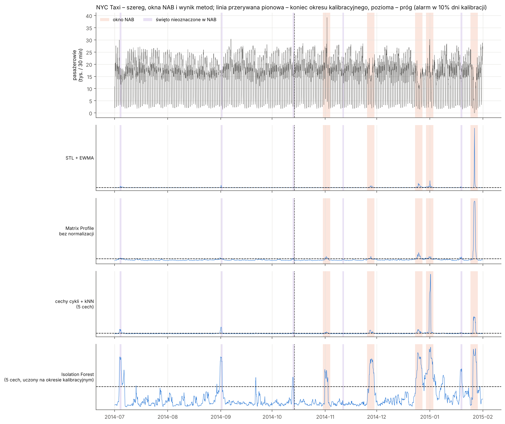
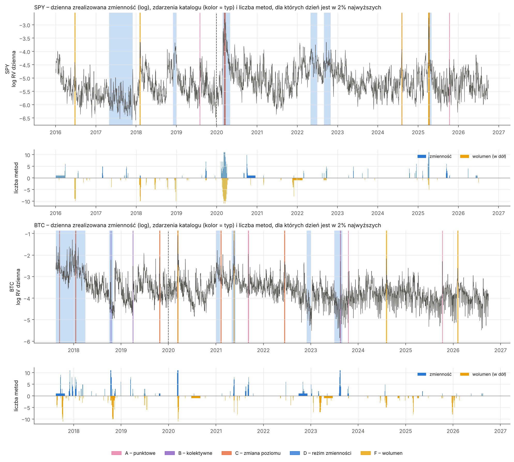
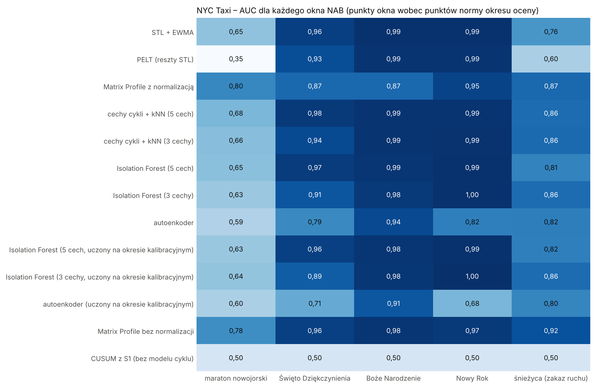
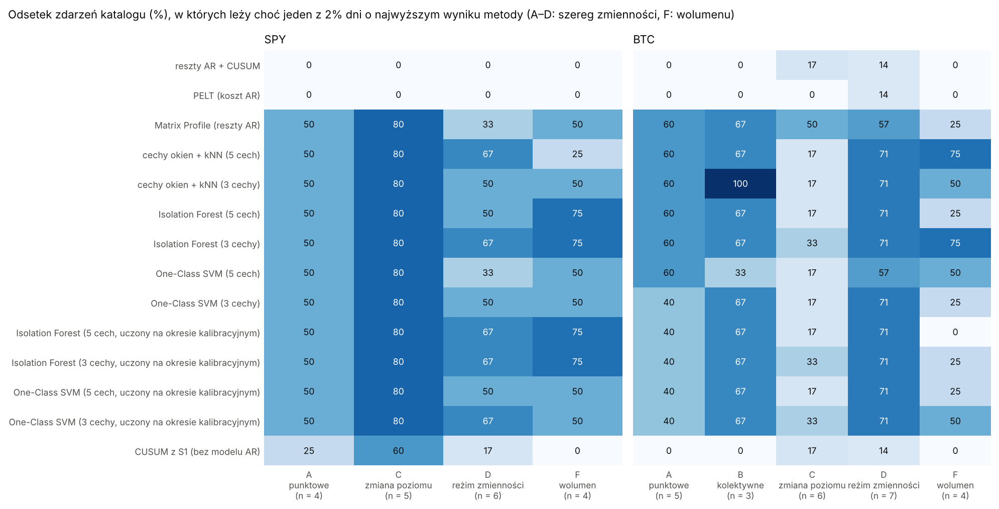
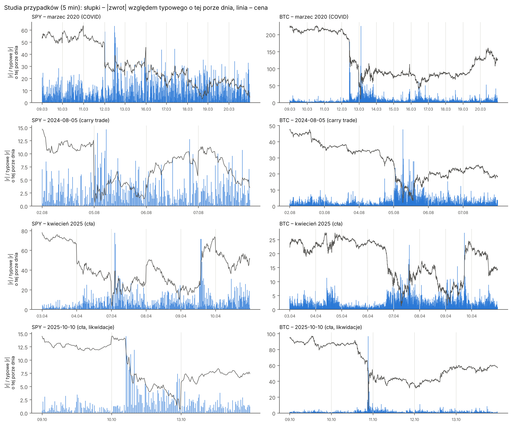

# Etap 2 – dane rzeczywiste: NYC Taxi, SPY, BTCUSDT

> Stan na **2026-10-29**. Realizacja kroku 10 z [plan_metod.md](plan_metod.md) (rozdz. 5.3 i 6): sprawdzenie metod
> z etapu 1 na danych rzeczywistych – **NYC Taxi** (etykiety NAB, ocena ilościowa) oraz **SPY i BTCUSDT** (katalog
> znanych zdarzeń, ocena na etykietach częściowych) i studia przypadków na danych 5-min. Wnioski z symulacji –
> [porownanie_s1_s3.md](porownanie_s1_s3.md). Wszystkie liczby pochodzą z plików CSV w `wyniki/rzeczywiste/`
> (tabele generowane automatycznie, zbiorczo – `wyniki/rzeczywiste/podsumowanie.md`); polecenia do odtworzenia –
> rozdz. 10.

## Spis treści

1. [Cel i sposób sprawdzenia](#1-cel-i-sposób-sprawdzenia)
2. [Najważniejsze wnioski](#2-najważniejsze-wnioski)
3. [Dane i właściwości szeregów](#3-dane-i-właściwości-szeregów)
4. [Ocena na danych rzeczywistych – próg, kara PELT, miary](#4-ocena-na-danych-rzeczywistych--próg-kara-pelt-miary)
5. [NYC Taxi – wyniki na etykietach NAB](#5-nyc-taxi--wyniki-na-etykietach-nab)
6. [SPY i BTCUSDT – wyniki na katalogu zdarzeń](#6-spy-i-btcusdt--wyniki-na-katalogu-zdarzeń)
7. [Studia przypadków na danych 5-min i dni FOMC](#7-studia-przypadków-na-danych-5-min-i-dni-fomc)
8. [Dane rzeczywiste a wnioski z symulacji](#8-dane-rzeczywiste-a-wnioski-z-symulacji)
9. [Ograniczenia](#9-ograniczenia)
10. [Jak odtworzyć wyniki](#10-jak-odtworzyć-wyniki)

---

## 1. Cel i sposób sprawdzenia

Etap 1 pokazał na symulacjach, że o skuteczności metody decyduje to, **czy jej model normy obejmuje strukturę
szeregu** (zależność, okresowość). Etap 2 sprawdza ten wniosek na szeregach, w których struktury nie ustawiliśmy
sami: najpierw rozpoznajemy właściwość szeregu (autokorelacja, okres), dobieramy do niej zestaw metod z etapu 1
i porównujemy z metodami „nie na ten szereg”.

| Zbiór | Szereg dla metod | Właściwość | Zestaw metod | Etykiety | Ocena |
|---|---|---|---|---|---|
| **NYC Taxi** (NAB) | log liczby pasażerów co 30 min, 10 320 punktów (215 dni) | okresowość: cykl dobowy (48) i tygodniowy (336) | jak S3 (okres STL = tydzień, okno = doba) | 5 okien NAB | ilościowa: wykryte okna, dni z fałszywym alarmem, AUC |
| **SPY** | dzienne log RV (zmienność) i wolumen, 2701 dni (2016-01-04 – 2026-09-30) | zależność: autokorelacja log RV 0,80 | jak S2 (model AR(1)), okno 10 dni | katalog: 24 zdarzenia | recall@N, dni z alarmem na rok, zgodność metod |
| **BTCUSDT** | jak SPY, doby UTC, 3331 dni (2017-08-17 – 2026-09-30) | zależność: autokorelacja log RV 0,76 | jak S2 | katalog: 25 zdarzeń | jak SPY |
| **SPY, BTC 5-min** | \|r\| po usunięciu sezonowości dobowej | – | – | 4 epizody + 5 dni FOMC | studia przypadków |

**Podział czasu.** W każdym zbiorze jest okres **kalibracyjny** („historia”, na której ustawia się próg, karę PELT
i uczy warianty ML) i okres **oceny** – tak, jak metoda działałaby w praktyce. NYC Taxi: kalibracja = pierwsze 105 dni
(2014-07-01 – 2014-10-13, przed pierwszym oknem NAB), ocena = 110 dni ze wszystkimi 5 oknami (79 dni bez anomalii).
SPY i BTC: kalibracja do 2019-12-31 (1006 / 866 dni), ocena od 2020-01-01.

---

## 2. Najważniejsze wnioski

1. **Na szeregu z etykietami (NYC Taxi) metody z modelem cyklu działają dobrze**: przy progu z okresu kalibracyjnego (alarm w 5% dni) STL + EWMA, Matrix Profile, cechy cykli + kNN i Isolation Forest wykrywają wszystkie 5 okien NAB przy 3–5% dni z fałszywym alarmem; AUC 0,87–0,93 (najlepiej Matrix Profile bez normalizacji – 0,93 i cechy cykli + kNN – 0,90). Kolejność jak w S3: cechy cyklu i porównanie fragmentów przed autoenkoderem (0,79).
2. **Bez modelu cyklu metoda nie działa – jak w eksperymencie przeniesienia.** CUSUM z S1 na tym samym szeregu ma AUC 0,50 i nie wykrywa żadnego okna: gładki cykl to silna zależność sąsiednich punktów, więc karta zależności rośnie przez cały szereg i wynik jest stały.
3. **Najtrudniejsze okno – maraton** (AUC 0,35–0,80): to zaburzenie kilku godzin jednego dnia, a nie całej doby; najłatwiejsze – Boże Narodzenie i Nowy Rok (AUC do 1,00). Metody wskazują też **święta nieoznaczone w NAB** (Labor Day – 1. miejsce wśród 105 dni kalibracji dla STL + EWMA i kNN, Dzień Martina Luthera Kinga – 11. miejsce na 110 dni oceny dla STL + EWMA) – w ocenie liczą się one jako fałszywe alarmy, choć są prawdziwymi zaburzeniami ruchu.
4. **Na danych rzeczywistych zawodzą założenia, które w symulacjach były spełnione.** Reszty STL w NYC Taxi mają autokorelację 0,98, więc test istotności odcinka w PELT (∝ √n) bez poprawki przy 61% z 31 sprawdzonych kar alarmuje w każdym dniu kalibracji (średnio 85% dni); z poprawką na efektywną liczbę obserwacji PELT działa (4/5 okien), ale słabiej od pozostałych. Dzienna zmienność SPY i BTC ma **długą pamięć** (autokorelacja log RV SPY przy przesunięciu 10 dni 0,53, a w AR(1) o tym samym φ = 0,80 byłoby 0,10): reszty AR + CUSUM sumują dodatnie reszty przez miesiące po kryzysie (maksimum wyniku w SPY na 212 dniach 2020-10-01 – 2021-08-04), a PELT z kosztem AR albo nie dzieli szeregu (kara ≥ 60), albo alarmuje w ≥ 11% dni kalibracji.
5. **Na rynkach najlepsze są metody okienkowe (cechy okien + kNN, Isolation Forest, One-Class SVM, Matrix Profile)** – recall@2% dla zdarzeń zmienności 43–67% (SPY: zmiany poziomu 80%, BTC: reżimy zmienności 71% dla kNN), przy 7,9–15,2 (SPY) i 2,1–5,2 (BTC) dniach z alarmem na rok. To powtarza wniosek z porównania S1–S3: przy niedopasowanym modelu tła najodporniejsze są metody okienkowe.
6. **Metody wskazują w dużej części różne dni** (indeks Jaccarda 2% najwyższych dni: mediana 0,30 w SPY, 0,31 w BTC); wspólne są największe kryzysy (marzec 2020, kwiecień 2025), a dni wskazywane przez większość metod to prawie zawsze zdarzenia z katalogu albo dni tuż obok (okno 10 dni „rozlewa” alarm na sąsiednie dni) – np. BTC 15–16.03.2020, których w katalogu nie ma.
7. **Szereg dzienny ukrywa anomalie trwające minuty i godziny.** Flash crash BTC 2025-10-10 (o 21:15 UTC ruch 96,8× większy od typowego o tej porze) i SPY 2024-08-05 (luka overnight) nie są w 2% najwyższych dni żadnej metody; flash crash BTC 2023-08-17 jest – bo wypadł w najspokojniejszym okresie (ten sam ruch jest anomalią albo nie, zależnie od otoczenia). Dni FOMC (typ E) mają o 14:00–14:55 ruchy 1,6–11,9× typowe dla tej godziny, ale w szeregu dziennym metody wskazują tylko 1 z 5 takich dni. Anomalie punktowe i struktury dobowej wymagają analizy na danych śróddziennych.
8. **Uczenie metod ML na okresie kalibracyjnym** daje na danych rzeczywistych mniej niż w symulacjach: w NYC Taxi Isolation Forest ma to samo AUC (0,88 → 0,88), autoenkoder traci (0,79 → 0,74); okres historyczny też zawiera anomalie (święta, kryzysy), a norma zmienia się w czasie (sezon świąteczny, nowe reżimy rynku). Zestaw cech (5 / 3) – bez wyraźnej różnicy.

---

## 3. Dane i właściwości szeregów

### 3.1 NYC Taxi

Liczba pasażerów taksówek w Nowym Jorku co 30 minut, 2014-07-01 – 2015-01-31, z Numenta Anomaly Benchmark (NAB).
Etykiety NAB: 5 okien po 207 punktów (≈ 4,3 doby) – maraton nowojorski, Święto Dziękczynienia, Boże Narodzenie,
Nowy Rok, śnieżyca z zakazem ruchu. Cykl jest **multiplikatywny** (w nocy ruch kilkukrotnie mniejszy, więc wahania
w dzień są większe) i **nie jest sinusem** (doby robocze i weekendowe mają inny przebieg), więc:
- metody dostają **log liczby pasażerów** – cykl staje się addytywny;
- dwa punkty zmiany czasu (2014-11-02 01:00 i 01:30 – zsumowane dwie godziny, maksimum szeregu, artefakt danych)
  dzielimy przez 2;
- okres STL = **tydzień** (P = 336), okno metod = **doba** (w = 48), bo doby różnią się dniem tygodnia;
- cechy cykli liczone są **względem profilu tygodnia** (mediana każdego punktu tygodnia), a nie względem sinusa jak w S3:
  poziom (średnia różnica od profilu), kształt (korelacja z profilem), faza (przesunięcie pierwszej harmonicznej
  doby względem profilu); w wariancie 5 cech dodatkowo odchylenie standardowe różnic i stosunek amplitud
  (`src/metody/baza.py`, `cechy_okien_rz`).



### 3.2 SPY i BTCUSDT – szeregi dzienne

Metody nie dostają ceny (trend), tylko jej przekształcenia, a dane 5-min (210 tys. / 958 tys. świec) są za duże dla
metod O(n²) (Matrix Profile, kNN). Dlatego z danych 5-min liczymy dla każdego dnia (SPY – sesja, BTC – doba UTC):
- **zmienność – log RV**: log zrealizowanej zmienności z 5-min log-zwrotów (bez przejścia przez noc w SPY i bez świec
  z zerowym wolumenem w BTC), przeskalowany do pełnego dnia (78 / 288 świec), żeby skrócone sesje nie wyglądały na
  „spokojne”;
- **wolumen**: log wolumenu dziennego (przeskalowany do pełnego dnia) minus mediana krocząca z 250 dni wyśrodkowana
  na danym dniu – usuwa wieloletni trend, zostawia kilkutygodniowe reżimy (mediana „wstecz” dawała na początku BTC,
  przy szybko rosnącym rynku 2017, sztuczne skoki);
- dni z < 50% świec są pomijane.

**Właściwość szeregów – zależność, ale z długą pamięcią.** Autokorelacja log RV przy przesunięciu o 1 dzień
(0,76–0,80) jest bliska φ = 0,7 z S2, więc zestaw metod = S2 (model AR(1)). Autokorelacja maleje jednak dużo wolniej
niż w AR(1) – po 10 dniach w AR(1) zostałoby φ¹⁰ ≈ 0,1, a w danych jest ok. 0,5:

| szereg | przesunięcie 1 d | przesunięcie 5 d | przesunięcie 10 d | przesunięcie 20 d | przesunięcie 50 d | AR(1): φ¹⁰ |
|---|---|---|---|---|---|---|
| SPY – log RV | 0,80 | 0,62 | 0,53 | 0,41 | 0,22 | 0,10 |
| SPY – wolumen | 0,68 | 0,44 | 0,34 | 0,16 | -0,03 | 0,02 |
| BTC – log RV | 0,76 | 0,57 | 0,47 | 0,46 | 0,35 | 0,06 |
| BTC – wolumen | 0,61 | 0,28 | 0,16 | 0,21 | 0,05 | 0,01 |

To różnica, której w symulacjach nie było: model AR(1) usuwa tylko część zależności, a reszty po nim są wciąż
dodatnio skorelowane przez tygodnie (rozdz. 6.3).



### 3.3 Katalog zdarzeń (SPY, BTC)

SPY i BTC nie mają etykiet. Katalog z przeglądu danych ([plan_metod.md](plan_metod.md), rozdz. 3; `src/rzeczywiste/katalog.py`)
zawiera 24 zdarzenia SPY i 25 zdarzeń BTC w sześciu typach: **A** – punktowe (skrajna świeca),
**B** – kolektywne (krótka seria), **C** – zmiana poziomu, **D** – reżim zmienności (wysokiej albo nienaturalnego spokoju),
**E** – zaburzenie struktury dobowej (dni FOMC), **F** – wolumen. Szereg zmienności oceniamy na typach A–D, wolumen – na F,
typ E – tylko w studiach przypadków 5-min (w szeregu dziennym go nie widać).

<details><summary>Pełny katalog zdarzeń</summary>

| zbiór | typ | daty | opis |
|---|---|---|---|
| SPY | A | 2019-08-01 | zapowiedź nowych ceł na Chiny (skrajny ruch na tle spokojnego dnia) |
| SPY | A | 2020-03-12 | COVID - dzień ze wstrzymaniem handlu |
| SPY | A | 2025-04-07 | fałszywa informacja o wstrzymaniu ceł - skok i powrót w 10 min |
| SPY | A | 2025-10-10 | zapowiedź ceł - spadek −0,55% w 5 min (z lokalny −16,5), ten sam dzień co BTC |
| SPY | C | 2020-03-09 | luka overnight −7% (COVID) |
| SPY | C | 2020-03-16 | luka overnight −11,6% (COVID) |
| SPY | C | 2020-03-18 | luka overnight (COVID) |
| SPY | C | 2024-08-05 | luka overnight −4,1% (rozpad carry trade na jenie) |
| SPY | C | 2025-04-09 | ogłoszenie 90-dniowego zawieszenia ceł - przesunięcie poziomu o ok. +6% |
| SPY | D | 2017-05-01 – 2017-11-30 | reżim nienaturalnego spokoju (RV 0,4× typowej) - anomalia „w dół” |
| SPY | D | 2018-12-01 – 2018-12-31 | podwyższona zmienność (2–2,8×) |
| SPY | D | 2020-02-24 – 2020-04-30 | COVID - zmienność do 6,4× typowej |
| SPY | D | 2022-05-01 – 2022-06-30 | bessa 2022 - podwyższona zmienność |
| SPY | D | 2022-09-01 – 2022-10-31 | bessa 2022 - podwyższona zmienność |
| SPY | D | 2025-04-01 – 2025-04-30 | cła - zmienność 2× (dzień 2025-04-07: 12×) |
| SPY | F | 2016-06-24 | Brexit - wolumen 3,7× |
| SPY | F | 2018-02-05 – 2018-02-06 | „Volmageddon” - wolumen 3,4× i 4,2× (rekord) |
| SPY | F | 2024-08-05 | wolumen 3,1× |
| SPY | F | 2025-04-04 – 2025-04-09 | cła - wolumen 3,0–3,8× |
| SPY | E | 2021-06-16 | FOMC 14:00 - skok zmienności w środku dnia |
| SPY | E | 2022-09-21 | FOMC 14:00 |
| SPY | E | 2023-12-13 | FOMC 14:00 |
| SPY | E | 2024-12-18 | FOMC |
| SPY | E | 2025-10-29 | FOMC |
| BTC | A | 2020-03-13 | odbicie po krachu COVID (+16,9% w 5 min) |
| BTC | A | 2021-09-07 | dzień wprowadzenia BTC jako waluty w Salwadorze (−10,4% w 5 min) |
| BTC | A | 2023-08-17 | flash crash w najspokojniejszym okresie (−9,1% w 5 min) |
| BTC | A | 2023-10-16 | fałszywa wiadomość o zatwierdzeniu ETF (+4,6%) |
| BTC | A | 2025-10-10 | kaskada likwidacji po zapowiedzi ceł (−7,6%) |
| BTC | B | 2018-10-15 | utrata parytetu USDT - anomalia notowania BTC/USDT |
| BTC | B | 2019-04-02 | seria wzrostów +3,5%, +3,2%, +3,1% w 45 min |
| BTC | B | 2021-05-19 | krach i odbicie: −7,6%, −10,2%, +9,0% w 25 min |
| BTC | C | 2017-09-14 | −19,2% w dobę (zakaz giełd w Chinach) |
| BTC | C | 2018-01-16 | −19,5% w dobę (krach po bańce) |
| BTC | C | 2019-10-25 | +16,8% w dobę |
| BTC | C | 2020-03-12 | −39,5% w dobę (COVID) |
| BTC | C | 2021-02-08 | +19,5% w dobę |
| BTC | C | 2022-06-13 | −15,4% w dobę (upadek Celsius) |
| BTC | D | 2017-08-17 – 2018-03-31 | bańka i krach - zmienność 2–3,7× |
| BTC | D | 2018-10-01 – 2018-10-31 | reżim spokoju (0,5×) |
| BTC | D | 2020-03-12 – 2020-03-13 | COVID - dzienna RV 9–13× |
| BTC | D | 2021-01-01 – 2021-01-31 | podwyższona zmienność 2,3× |
| BTC | D | 2021-05-01 – 2021-05-31 | podwyższona zmienność 2,5× |
| BTC | D | 2022-12-01 – 2022-12-31 | reżim spokoju (0,5×) |
| BTC | D | 2023-07-01 – 2023-08-31 | reżim spokoju (0,5×), tło flash crashu 2023-08-17 |
| BTC | F | 2020-03-13 | wolumen 5,2× |
| BTC | F | 2021-05-19 | wolumen 4,1× |
| BTC | F | 2024-08-05 | wolumen 5,9× (rekord) - to samo zdarzenie co w SPY |
| BTC | F | 2026-02-05 – 2026-02-06 | wolumen 5,0× i 4,3× |

</details>

---

## 4. Ocena na danych rzeczywistych – próg, kara PELT, miary

**Jednostka oceny – dzień.** W etapie 1 próg ustawiano na szeregach bez anomalii (10% fałszywych alarmów). Na danych
rzeczywistych takich szeregów nie ma, więc (`src/rzeczywiste/wspolne.py`):
- **próg z okresu kalibracyjnego (wariant główny)** – kwantyl (1 − α) dziennych maksimów wyniku metody w dniach
  kalibracji, czyli alarm w α dni „historii”; NYC Taxi: α = 2, 5, 10%; SPY i BTC: α = 1, 2, 5% (dzień z alarmem
  co 2–10 tygodni);
- **równy budżet (wariant porównawczy, NYC)** – próg tak, by alarm był w α dni bez anomalii okresu oceny; to
  porównanie metod przy tej samej liczbie fałszywych alarmów, ale z wiedzą, której w praktyce nie ma;
- **kara PELT** – wybierana z siatki 31 kar (3 … 3000, geometrycznie): największy odsetek dni kalibracji z alarmem
  nie większy niż α. Siatka zamiast bisekcji, bo na danych rzeczywistych odsetek alarmów **nie maleje monotonicznie**
  z karą (większa kara łączy dwa krótkie odcinki w jeden dłuższy, który może przekroczyć próg istotności);
- **poprawka na zależność w PELT** (tylko dane rzeczywiste, flaga `korekta_zaleznosci`): test istotności odcinka
  liczony z efektywnej liczby obserwacji n_eff = n · (1 − ρ) / (1 + ρ), ρ – autokorelacja reszt przy przesunięciu 1.

**Miary.**
- NYC Taxi: okno NAB **wykryte** = alarm w oknie ± 24 punkty (pół doby); **dni z fałszywym alarmem** = odsetek z 79 dni
  okresu oceny w całości poza oknami (± 24 punkty); **AUC i AP** – punkty okien wobec punktów normy okresu oceny.
- SPY, BTC: **recall@N** – odsetek zdarzeń katalogu, w których (± 1 dzień) leży choć jeden z N dni o najwyższym
  wyniku metody, N = 1, 2, 5% dni całego szeregu (miara niezależna od progu); **wykrycie przy progu z kalibracji**
  (zdarzenia okresu oceny) i **dni z alarmem na rok**; **zgodność metod** – indeks Jaccarda zbiorów 2% najwyższych dni
  i liczba metod (z 13 głównych), które mają dany dzień w swoich 2% najwyższych. Katalog jest niekompletny, więc
  precyzji nie liczymy (rozdz. 9).

---

## 5. NYC Taxi – wyniki na etykietach NAB

### 5.1 Wykryte okna, fałszywe alarmy, AUC

Próg z okresu kalibracyjnego – wykryte okna (z 5) i odsetek dni bez anomalii okresu oceny z alarmem:

| metoda | α = 2%: okna · dni z fałszywym alarmem | α = 5%: okna · dni z fałszywym alarmem | α = 10%: okna · dni z fałszywym alarmem | AUC | AP |
|---|---|---|---|---|---|
| STL + EWMA | 4/5 · 1% | 5/5 · 5% | 5/5 · 15% | 0,87 | 0,78 |
| PELT (reszty STL) | 2/5 · 0% | 4/5 · 0% | 4/5 · 28% | 0,77 | 0,64 |
| Matrix Profile z normalizacją | 4/5 · 3% | 5/5 · 3% | 5/5 · 6% | 0,87 | 0,70 |
| cechy cykli + kNN (5 cech) | 2/5 · 0% | 5/5 · 3% | 5/5 · 5% | 0,90 | 0,84 |
| cechy cykli + kNN (3 cechy) | 2/5 · 0% | 5/5 · 3% | 5/5 · 6% | 0,89 | 0,82 |
| Isolation Forest (5 cech) | 3/5 · 0% | 5/5 · 3% | 5/5 · 8% | 0,88 | 0,82 |
| Isolation Forest (3 cechy) | 3/5 · 0% | 5/5 · 3% | 5/5 · 4% | 0,87 | 0,81 |
| autoenkoder | 3/5 · 4% | 3/5 · 4% | 3/5 · 10% | 0,79 | 0,54 |
| Isolation Forest (5 cech, uczony na okresie kalibracyjnym) | 3/5 · 0% | 5/5 · 3% | 5/5 · 10% | 0,88 | 0,82 |
| Isolation Forest (3 cechy, uczony na okresie kalibracyjnym) | 3/5 · 0% | 5/5 · 3% | 5/5 · 4% | 0,88 | 0,82 |
| autoenkoder (uczony na okresie kalibracyjnym) | 4/5 · 5% | 4/5 · 10% | 4/5 · 15% | 0,74 | 0,52 |
| Matrix Profile bez normalizacji | 5/5 · 3% | 5/5 · 4% | 5/5 · 6% | 0,93 | 0,82 |
| CUSUM z S1 (bez modelu cyklu) | 0/5 · 0% | 0/5 · 0% | 0/5 · 0% | 0,50 | 0,21 |

Równy budżet (alarm w α dni bez anomalii okresu oceny):

| metoda | α = 2%: okna · dni z fałszywym alarmem | α = 5%: okna · dni z fałszywym alarmem | α = 10%: okna · dni z fałszywym alarmem | AUC | AP |
|---|---|---|---|---|---|
| STL + EWMA | 5/5 · 3% | 5/5 · 5% | 5/5 · 10% | 0,87 | 0,78 |
| PELT (reszty STL) | 4/5 · 1% | 4/5 · 4% | 4/5 · 5% | 0,77 | 0,64 |
| Matrix Profile z normalizacją | 5/5 · 3% | 5/5 · 5% | 5/5 · 10% | 0,87 | 0,70 |
| cechy cykli + kNN (5 cech) | 5/5 · 3% | 5/5 · 5% | 5/5 · 10% | 0,90 | 0,84 |
| cechy cykli + kNN (3 cechy) | 5/5 · 3% | 5/5 · 5% | 5/5 · 10% | 0,89 | 0,82 |
| Isolation Forest (5 cech) | 5/5 · 3% | 5/5 · 5% | 5/5 · 10% | 0,88 | 0,82 |
| Isolation Forest (3 cechy) | 5/5 · 3% | 5/5 · 5% | 5/5 · 10% | 0,87 | 0,81 |
| autoenkoder | 3/5 · 3% | 3/5 · 5% | 3/5 · 10% | 0,79 | 0,54 |
| Isolation Forest (5 cech, uczony na okresie kalibracyjnym) | 5/5 · 3% | 5/5 · 5% | 5/5 · 10% | 0,88 | 0,82 |
| Isolation Forest (3 cechy, uczony na okresie kalibracyjnym) | 5/5 · 3% | 5/5 · 5% | 5/5 · 10% | 0,88 | 0,82 |
| autoenkoder (uczony na okresie kalibracyjnym) | 3/5 · 3% | 4/5 · 5% | 4/5 · 10% | 0,74 | 0,52 |
| Matrix Profile bez normalizacji | 5/5 · 3% | 5/5 · 5% | 5/5 · 10% | 0,93 | 0,82 |
| CUSUM z S1 (bez modelu cyklu) | 0/5 · 0% | 0/5 · 0% | 0/5 · 0% | 0,50 | 0,21 |

- Przy α = 5% **wszystkie 5 okien wykrywają wszystkie metody z modelem cyklu poza PELT i autoenkoderem** (STL + EWMA,
  Matrix Profile, cechy cykli + kNN, Isolation Forest – w każdym wariancie) przy 3–5%
  dni z fałszywym alarmem. Przy równym budżecie te same metody mają 5/5 już przy α = 2%; PELT –
  4/5, autoenkoder – 3/5.
- **Próg z kalibracji przenosi się na okres oceny dobrze** dla metod cech i Matrix Profile (przy α = 10%:
  4–10% dni z fałszywym alarmem), gorzej dla STL + EWMA (15%) i PELT (28%):
  sezon świąteczny (listopad–styczeń) ma inny przebieg niż lato, a karta EWMA i PELT reagują na każdą trwałą zmianę.
- **Najwyższe AUC – Matrix Profile bez normalizacji (0,93)**, potem cechy cykli + kNN (0,90).
  W NYC Taxi anomalie to głównie **spadki poziomu ruchu** całych dób (święta, śnieżyca), a normalizacja okna
  w Matrix Profile usuwa właśnie poziom – stąd przewaga wersji bez normalizacji, odwrotnie niż w S3 (zmiany kształtu
  cyklu przy stałym poziomie).
- **CUSUM z S1 (bez modelu cyklu): AUC 0,50, 0/5 okien** – karta zależności rośnie przez cały szereg
  (gładki cykl = silna zależność sąsiednich punktów), wynik jest stały. To ten sam efekt co w eksperymencie
  przeniesienia z etapu 1 (metody S1 na szeregach S3).



### 5.2 Okna NAB – które są trudne

| metoda | maraton nowojorski | Święto Dziękczynienia | Boże Narodzenie | Nowy Rok | śnieżyca (zakaz ruchu) |
|---|---|---|---|---|---|
| STL + EWMA | 0,65 | 0,96 | 0,99 | 0,99 | 0,76 |
| PELT (reszty STL) | 0,35 | 0,93 | 0,99 | 0,99 | 0,60 |
| Matrix Profile z normalizacją | 0,80 | 0,87 | 0,87 | 0,95 | 0,87 |
| cechy cykli + kNN (5 cech) | 0,68 | 0,98 | 0,99 | 0,99 | 0,86 |
| cechy cykli + kNN (3 cechy) | 0,66 | 0,94 | 0,99 | 0,99 | 0,86 |
| Isolation Forest (5 cech) | 0,65 | 0,97 | 0,99 | 0,99 | 0,81 |
| Isolation Forest (3 cechy) | 0,63 | 0,91 | 0,98 | 1,00 | 0,86 |
| autoenkoder | 0,59 | 0,79 | 0,94 | 0,82 | 0,82 |
| Isolation Forest (5 cech, uczony na okresie kalibracyjnym) | 0,63 | 0,96 | 0,98 | 0,99 | 0,82 |
| Isolation Forest (3 cechy, uczony na okresie kalibracyjnym) | 0,64 | 0,89 | 0,98 | 1,00 | 0,86 |
| autoenkoder (uczony na okresie kalibracyjnym) | 0,60 | 0,71 | 0,91 | 0,68 | 0,80 |
| Matrix Profile bez normalizacji | 0,78 | 0,96 | 0,98 | 0,97 | 0,92 |
| CUSUM z S1 (bez modelu cyklu) | 0,50 | 0,50 | 0,50 | 0,50 | 0,50 |

- **Boże Narodzenie i Nowy Rok** – całe doby o innym przebiegu i niższym poziomie: AUC
  0,87–1,00
  dla wszystkich metod z modelem cyklu poza autoenkoderem (autoenkoder: do 0,68
  na Nowym Roku).
- **Maraton** – najtrudniejszy (AUC 0,35–0,80):
  zmiana ruchu dotyczy kilku godzin jednej niedzieli, a cała doba jest bliska typowej. Najlepiej radzi sobie Matrix
  Profile z normalizacją (0,80) – porównuje kształt doby, a nie jej średnie cechy.
- **Śnieżyca** (zakaz ruchu 26–27.01.2015) – wysoko u metod porównujących fragmenty (Matrix Profile bez normalizacji
  0,92), słabiej u PELT (0,60) i STL + EWMA (0,76).

### 5.3 Święta nieoznaczone w NAB

Etykiety NAB nie obejmują innych świąt, a te też zmieniają ruch. Miejsce dnia w rankingu dziennych maksimów wyniku
(w swoim okresie: kalibracja 105 dni, ocena 110 dni; 1 = dzień najbardziej nietypowy):

| dzień | okres | STL + EWMA | Matrix Profile bez normalizacji | cechy cykli + kNN (5 cech) | Isolation Forest (5 cech) | Isolation Forest (5 cech, uczony na okresie kalibracyjnym) | autoenkoder |
|---|---|---|---|---|---|---|---|
| 2014-07-04 – Dzień Niepodległości | kalibracja | 2 | 2 | 4 | 3 | 3 | 16 |
| 2014-09-01 – Labor Day | kalibracja | 1 | 7 | 1 | 2 | 2 | 1 |
| 2014-10-13 – Columbus Day | kalibracja | 5 | 4 | 6 | 8 | 7 | 31 |
| 2014-11-11 – Dzień Weterana | ocena | 44 | 48 | 74 | 78 | 69 | 100 |
| 2015-01-19 – Dzień Martina Luthera Kinga | ocena | 11 | 11 | 18 | 16 | 15 | 24 |

Labor Day i Dzień Niepodległości są w pierwszej dziesiątce dni kalibracji wszystkich metod poza autoenkoderem
(Dzień Niepodległości – 16. miejsce u autoenkodera), a Dzień Martina Luthera Kinga –
na miejscach 11–18
okresu oceny; Dzień Weterana – nie (miejsca 44+). **Metody wskazują prawdziwe zaburzenia, które ocena NAB liczy jako
fałszywe alarmy** – część „fałszywych alarmów” z tabeli 5.1 to takie dni. Druga konsekwencja: okres kalibracyjny też
zawiera anomalie (3 święta w 105 dniach), więc próg z kalibracji i metody uczone na niej mają w „normie” nietypowe dni.

### 5.4 PELT na resztach STL – poprawka na zależność

Reszty STL w NYC Taxi mają autokorelację **0,98** (odchylenia od profilu tygodnia trwają godzinami, więc reszty
zmieniają się płynnie z półgodziny na półgodzinę). Test istotności odcinka w PELT zakłada niezależne obserwacje – przy takiej zależności każdy dłuższy
odcinek wygląda na istotny: bez poprawki w 61% z 31 kar alarm jest w **każdym**
dniu kalibracji (średnio 85% dni). Z poprawką n_eff odsetek alarmów da się ustawić, ale **nie maleje
monotonicznie** z karą (np. 10,5% dni przy karach 378–949, 92% przy 1194–1504, 0% od 1893). Wybrana kara:
3 / 8 / 238 dla α = 2 / 5 / 10%. Wynik: 2/5, 4/5,
4/5 okien, AUC 0,77 – razem z autoenkoderem najsłabiej z metod z modelem cyklu, a dla
α = 10% kara wybrana na kalibracji daje 28% dni z fałszywym alarmem w ocenie (przeniesienie
kary między okresami jest niestabilne). Pełna zależność alarmów od kary: `wyniki/rzeczywiste/nyc_taxi_pelt_kary.csv`.

### 5.5 Ustawienia metod

- **5 czy 3 cechy** – bez różnicy (kNN: AUC 0,90 / 0,89; Isolation Forest:
  0,88 / 0,87): trzy cechy względem profilu (poziom, kształt, faza) niosą całą informację.
- **Uczenie na okresie kalibracyjnym** – Isolation Forest bez zmian (0,88 → 0,88),
  autoenkoder słabiej (0,79 → 0,74). W symulacjach uczenie na szeregach bez anomalii
  pomagało Isolation Forest (maskowanie); tu okres kalibracyjny też zawiera anomalie (święta), a sezon świąteczny
  różni się od lata, więc „czysta norma” nie istnieje.
- **Autoenkoder** – najsłabszy z metod z modelem cyklu (3/5 okien przy α = 5%, AUC 0,79), jak w S3.

---

## 6. SPY i BTCUSDT – wyniki na katalogu zdarzeń

### 6.1 Szereg zmienności (log RV) – zdarzenia A–D

W kolumnach typów: recall@N dla N = 1 / 2 / 5% dni (27 / 54 /
135 dni SPY, 33 / 67 / 167 dni BTC).
Dwie ostatnie kolumny – próg z kalibracji, α = 2%.

**SPY:**

| metoda | A – punktowe (n = 4): N = 1 / 2 / 5% | C – zmiana poziomu (n = 5): N = 1 / 2 / 5% | D – reżim zmienności (n = 6): N = 1 / 2 / 5% | wykryte w okresie oceny (próg α = 2%) | dni z alarmem na rok (ocena) |
|---|---|---|---|---|---|
| reszty AR + CUSUM | 0% / 0% / 0% | 0% / 0% / 0% | 0% / 0% / 0% | 0% | 31,5 |
| PELT (koszt AR) | 0% / 0% / 0% | 0% / 0% / 0% | 0% / 0% / 0% | 0% | 0,0 |
| Matrix Profile (reszty AR) | 25% / 50% / 100% | 80% / 80% / 80% | 33% / 33% / 33% | 75% | 9,7 |
| cechy okien + kNN (5 cech) | 25% / 50% / 50% | 60% / 80% / 80% | 33% / 67% / 100% | 83% | 10,4 |
| cechy okien + kNN (3 cechy) | 50% / 50% / 50% | 80% / 80% / 80% | 50% / 50% / 100% | 83% | 10,7 |
| Isolation Forest (5 cech) | 50% / 50% / 75% | 80% / 80% / 80% | 33% / 50% / 83% | 83% | 14,7 |
| Isolation Forest (3 cechy) | 50% / 50% / 50% | 80% / 80% / 80% | 33% / 67% / 100% | 83% | 15,2 |
| One-Class SVM (5 cech) | 50% / 50% / 50% | 80% / 80% / 80% | 33% / 33% / 83% | 75% | 9,8 |
| One-Class SVM (3 cechy) | 50% / 50% / 50% | 80% / 80% / 80% | 50% / 50% / 100% | 83% | 9,5 |
| Isolation Forest (5 cech, uczony na okresie kalibracyjnym) | 50% / 50% / 75% | 80% / 80% / 80% | 50% / 67% / 83% | 83% | 11,4 |
| Isolation Forest (3 cechy, uczony na okresie kalibracyjnym) | 50% / 50% / 50% | 80% / 80% / 80% | 67% / 67% / 100% | 75% | 12,9 |
| One-Class SVM (5 cech, uczony na okresie kalibracyjnym) | 25% / 50% / 50% | 60% / 80% / 80% | 17% / 50% / 83% | 75% | 8,3 |
| One-Class SVM (3 cechy, uczony na okresie kalibracyjnym) | 50% / 50% / 50% | 80% / 80% / 80% | 50% / 67% / 67% | 75% | 7,9 |
| CUSUM z S1 (bez modelu AR) | 25% / 25% / 25% | 60% / 60% / 60% | 17% / 17% / 17% | 58% | 116,1 |

**BTC:**

| metoda | A – punktowe (n = 5): N = 1 / 2 / 5% | B – kolektywne (n = 3): N = 1 / 2 / 5% | C – zmiana poziomu (n = 6): N = 1 / 2 / 5% | D – reżim zmienności (n = 7): N = 1 / 2 / 5% | wykryte w okresie oceny (próg α = 2%) | dni z alarmem na rok (ocena) |
|---|---|---|---|---|---|---|
| reszty AR + CUSUM | 0% / 0% / 0% | 0% / 0% / 0% | 17% / 17% / 33% | 14% / 14% / 14% | 0% | 0,0 |
| PELT (koszt AR) | 0% / 0% / 0% | 0% / 0% / 0% | 0% / 0% / 0% | 0% / 14% / 14% | 36% | 216,5 |
| Matrix Profile (reszty AR) | 40% / 60% / 100% | 33% / 67% / 100% | 33% / 50% / 50% | 43% / 57% / 71% | 36% | 2,5 |
| cechy okien + kNN (5 cech) | 40% / 60% / 80% | 67% / 67% / 100% | 17% / 17% / 50% | 71% / 71% / 71% | 57% | 4,6 |
| cechy okien + kNN (3 cechy) | 60% / 60% / 80% | 33% / 100% / 100% | 17% / 17% / 33% | 57% / 71% / 86% | 57% | 4,3 |
| Isolation Forest (5 cech) | 60% / 60% / 100% | 33% / 67% / 100% | 17% / 17% / 33% | 57% / 71% / 71% | 57% | 5,2 |
| Isolation Forest (3 cechy) | 40% / 60% / 60% | 33% / 67% / 100% | 33% / 33% / 33% | 57% / 71% / 86% | 50% | 3,7 |
| One-Class SVM (5 cech) | 40% / 60% / 80% | 33% / 33% / 67% | 17% / 17% / 17% | 57% / 57% / 71% | 36% | 4,7 |
| One-Class SVM (3 cechy) | 40% / 40% / 60% | 33% / 67% / 67% | 17% / 17% / 33% | 57% / 71% / 86% | 36% | 4,7 |
| Isolation Forest (5 cech, uczony na okresie kalibracyjnym) | 40% / 40% / 60% | 33% / 67% / 100% | 17% / 17% / 17% | 57% / 71% / 71% | 36% | 2,1 |
| Isolation Forest (3 cechy, uczony na okresie kalibracyjnym) | 40% / 40% / 60% | 33% / 67% / 67% | 17% / 33% / 33% | 57% / 71% / 86% | 50% | 4,0 |
| One-Class SVM (5 cech, uczony na okresie kalibracyjnym) | 40% / 40% / 40% | 33% / 67% / 67% | 17% / 17% / 33% | 57% / 71% / 86% | 36% | 2,8 |
| One-Class SVM (3 cechy, uczony na okresie kalibracyjnym) | 40% / 40% / 60% | 33% / 67% / 67% | 17% / 33% / 50% | 57% / 71% / 71% | 50% | 3,0 |
| CUSUM z S1 (bez modelu AR) | 0% / 0% / 0% | 0% / 0% / 0% | 17% / 17% / 33% | 14% / 14% / 14% | 0% | 0,0 |

- **Metody okienkowe** (Matrix Profile na resztach AR, cechy okien + kNN, Isolation Forest, One-Class SVM) wskazują
  w swoich 2% najwyższych dniach 40–60% zdarzeń punktowych (A),
  80% zmian poziomu SPY (C) i
  33–71% reżimów zmienności (D); przy progu z kalibracji wykrywają 75–83%
  zdarzeń okresu oceny SPY i 36–57% BTC.
- **Mniej alarmów w BTC** (2,1–5,2
  dni na rok wobec 7,9–15,2 w SPY),
  bo okres kalibracyjny BTC to bańka i krach 2017–2018 – najbardziej zmienny okres całego szeregu, więc próg jest
  wysoki. W SPY jest odwrotnie: kalibracja 2016–2019 jest spokojna, a ocena zawiera COVID, bessę 2022 i cła 2025.
- **BTC – zmiany poziomu (C) są trudne** dla metod cech (17–33%), bo dzienny szereg zmienności nie zawiera kierunku
  ruchu ceny: dzień −39,5% jest wykryty (bo ma skrajną zmienność), a dni przesunięcia poziomu bez skrajnej zmienności – nie.
- **Warianty 5 / 3 cech i uczenie na kalibracji** zmieniają recall o pojedyncze zdarzenia (przy 3–7 zdarzeniach
  jednego typu jedno zdarzenie to 14–33 punkty procentowe) – bez stałego kierunku.

### 6.2 Szereg wolumenu – zdarzenia F

**SPY:**

| metoda | F – wolumen (n = 4): N = 1 / 2 / 5% | wykryte w okresie oceny (próg α = 2%) | dni z alarmem na rok (ocena) |
|---|---|---|---|
| reszty AR + CUSUM | 0% / 0% / 0% | 0% | 55,2 |
| PELT (koszt AR) | 0% / 0% / 0% | 100% | 185,2 |
| Matrix Profile (reszty AR) | 50% / 50% / 50% | 50% | 1,9 |
| cechy okien + kNN (5 cech) | 25% / 25% / 75% | 0% | 5,9 |
| cechy okien + kNN (3 cechy) | 0% / 50% / 50% | 0% | 4,9 |
| Isolation Forest (5 cech) | 50% / 75% / 75% | 50% | 2,8 |
| Isolation Forest (3 cechy) | 25% / 75% / 75% | 50% | 4,6 |
| One-Class SVM (5 cech) | 50% / 50% / 50% | 0% | 5,6 |
| One-Class SVM (3 cechy) | 25% / 50% / 50% | 0% | 4,5 |
| Isolation Forest (5 cech, uczony na okresie kalibracyjnym) | 50% / 75% / 75% | 50% | 0,9 |
| Isolation Forest (3 cechy, uczony na okresie kalibracyjnym) | 50% / 75% / 75% | 50% | 1,6 |
| One-Class SVM (5 cech, uczony na okresie kalibracyjnym) | 25% / 50% / 50% | 0% | 4,3 |
| One-Class SVM (3 cechy, uczony na okresie kalibracyjnym) | 0% / 50% / 75% | 0% | 4,2 |
| CUSUM z S1 (bez modelu AR) | 0% / 0% / 25% | 0% | 0,0 |

**BTC:**

| metoda | F – wolumen (n = 4): N = 1 / 2 / 5% | wykryte w okresie oceny (próg α = 2%) | dni z alarmem na rok (ocena) |
|---|---|---|---|
| reszty AR + CUSUM | 0% / 0% / 0% | 25% | 65,0 |
| PELT (koszt AR) | 0% / 0% / 0% | 50% | 187,6 |
| Matrix Profile (reszty AR) | 25% / 25% / 100% | 50% | 8,9 |
| cechy okien + kNN (5 cech) | 50% / 75% / 75% | 75% | 5,6 |
| cechy okien + kNN (3 cechy) | 25% / 50% / 75% | 25% | 5,2 |
| Isolation Forest (5 cech) | 25% / 25% / 75% | 25% | 4,1 |
| Isolation Forest (3 cechy) | 25% / 75% / 100% | 0% | 1,0 |
| One-Class SVM (5 cech) | 25% / 50% / 75% | 25% | 3,4 |
| One-Class SVM (3 cechy) | 25% / 25% / 100% | 25% | 2,2 |
| Isolation Forest (5 cech, uczony na okresie kalibracyjnym) | 0% / 0% / 50% | 0% | 4,0 |
| Isolation Forest (3 cechy, uczony na okresie kalibracyjnym) | 25% / 25% / 100% | 0% | 1,2 |
| One-Class SVM (5 cech, uczony na okresie kalibracyjnym) | 25% / 25% / 50% | 25% | 4,1 |
| One-Class SVM (3 cechy, uczony na okresie kalibracyjnym) | 25% / 50% / 75% | 25% | 4,1 |
| CUSUM z S1 (bez modelu AR) | 0% / 0% / 0% | 0% | 0,0 |

Cztery zdarzenia wolumenu w każdym zbiorze – jedno zdarzenie = 25 punktów procentowych. Isolation Forest
(SPY, 75%) i cechy okien + kNN (BTC, 75%)
wskazują większość z nich w 2% najwyższych dni. Zgodność metod na wolumenie BTC jest najniższa
(mediana Jaccarda 0,16) – szereg po usunięciu trendu ma słabszą zależność
(autokorelacja 0,61) i mniej wyraźnych epizodów.

### 6.3 Dlaczego zawodzą reszty AR + CUSUM i PELT z kosztem AR

Najlepsza metoda S2 (reszty AR + CUSUM) ma na rynkach recall bliski zera i dużo alarmów (SPY: 31,5
dni z alarmem na rok, BTC wolumen: 65,0):
- **długa pamięć** (rozdz. 3.2): po kryzysie zmienność wraca do normy przez miesiące, reszty AR(1) są przez ten czas
  dodatnie, a CUSUM je sumuje – wynik rośnie aż do **plateau** (SPY: maksimum na 212 dniach 2020-10-01 – 2021-08-04,
  BTC: 237 dni 2017-08-18 – 2018-04-12). Najwyższy wynik nie trafia w dzień zdarzenia, tylko w długi okres po nim,
  więc recall@N ≈ 0;
- **PELT z kosztem AR – wszystko albo nic**: na zmienności SPY kara ≤ 48 daje alarm w ≥ 11% dni kalibracji
  (do 100%), kara ≥ 60 – brak podziału szeregu; w BTC jedyny podział przy karach 95–189 nie ma alarmów
  w kalibracji, ale obejmuje 59% dni oceny. Stąd recall bliski 0 i 185,2–216,5 dni z alarmem na rok
  (SPY – wolumen, BTC – zmienność i wolumen).

W symulacjach S2 obie metody były najlepsze, bo tło było **dokładnie** AR(1). To najmocniejszy przykład wniosku
z etapu 1: zły (zbyt prosty) model tła szkodzi bardziej niż model ogólniejszy – metody okienkowe nie zakładają
postaci zależności i radzą sobie z długą pamięcią.

**CUSUM z S1 (bez modelu AR)** – porównawczo: w SPY wykrywa 60% zmian poziomu,
ale kosztem 116,1 dni z alarmem na rok (zależność = ciągłe alarmy, jak w S2).



### 6.4 Zgodność metod i dni wskazane przez większość metod

Indeks Jaccarda zbiorów 2% najwyższych dni (pary 13 metod głównych): mediana 0,30 (SPY, zmienność),
0,33 (SPY, wolumen), 0,31 (BTC, zmienność), 0,16
(BTC, wolumen) – metody wskazują w dużej części **różne** dni. Wspólne są dni największych kryzysów (maksymalnie 11 z 13 metod –
reszty AR + CUSUM i PELT nie wskazują ich nigdy):

**SPY** – 12 dni z największą liczbą metod (przy remisie – wyższy log RV):

| dzień | metody (z 13) z dniem w top 2% | log RV | zdarzenie w katalogu |
|---|---|---|---|
| 2025-04-07 | 11 | -2,74 | A: fałszywa informacja o wstrzymaniu ceł - skok i powrót w 10 min; D: cła - zmienność 2× (dzień 2025-04-07: 12×); F: cła - wolumen 3,0–3,8× |
| 2020-03-12 | 11 | -2,79 | A: COVID - dzień ze wstrzymaniem handlu; D: COVID - zmienność do 6,4× typowej |
| 2020-03-16 | 11 | -2,94 | C: luka overnight −11,6% (COVID); D: COVID - zmienność do 6,4× typowej |
| 2020-03-18 | 11 | -2,98 | C: luka overnight (COVID); D: COVID - zmienność do 6,4× typowej |
| 2020-03-13 | 11 | -3,01 | D: COVID - zmienność do 6,4× typowej |
| 2020-03-17 | 11 | -3,02 | D: COVID - zmienność do 6,4× typowej |
| 2025-04-09 | 11 | -3,09 | C: ogłoszenie 90-dniowego zawieszenia ceł - przesunięcie poziomu o ok. +6%; D: cła - zmienność 2× (dzień 2025-04-07: 12×); F: cła - wolumen 3,0–3,8× |
| 2020-03-09 | 11 | -3,34 | C: luka overnight −7% (COVID); D: COVID - zmienność do 6,4× typowej |
| 2025-04-10 | 11 | -3,37 | D: cła - zmienność 2× (dzień 2025-04-07: 12×) |
| 2020-03-10 | 11 | -3,44 | D: COVID - zmienność do 6,4× typowej |
| 2025-04-08 | 11 | -3,54 | D: cła - zmienność 2× (dzień 2025-04-07: 12×); F: cła - wolumen 3,0–3,8× |
| 2020-03-06 | 11 | -3,77 | D: COVID - zmienność do 6,4× typowej |

**BTC:**

| dzień | metody (z 13) z dniem w top 2% | log RV | zdarzenie w katalogu |
|---|---|---|---|
| 2020-03-13 | 11 | -1,10 | A: odbicie po krachu COVID (+16,9% w 5 min); D: COVID - dzienna RV 9–13×; F: wolumen 5,2× |
| 2020-03-12 | 11 | -1,51 | C: −39,5% w dobę (COVID); D: COVID - dzienna RV 9–13× |
| 2020-03-16 | 11 | -1,95 | – (brak w katalogu) |
| 2018-10-15 | 11 | -2,23 | B: utrata parytetu USDT - anomalia notowania BTC/USDT; D: reżim spokoju (0,5×) |
| 2023-08-17 | 11 | -2,29 | A: flash crash w najspokojniejszym okresie (−9,1% w 5 min); D: reżim spokoju (0,5×), tło flash crashu 2023-08-17 |
| 2020-03-15 | 11 | -2,35 | – (brak w katalogu) |
| 2020-03-14 | 11 | -2,44 | – (brak w katalogu) |
| 2017-12-02 | 11 | -2,89 | D: bańka i krach - zmienność 2–3,7× |
| 2020-03-10 | 11 | -3,20 | – (brak w katalogu) |
| 2018-10-11 | 11 | -3,25 | D: reżim spokoju (0,5×) |
| 2020-03-11 | 11 | -3,28 | – (brak w katalogu) |
| 2018-10-12 | 11 | -4,26 | D: reżim spokoju (0,5×) |

- W SPY wszystkie te dni są w katalogu (COVID, cła 2025).
- W BTC 2020-03-10 … 03-16 to krach COVID – w katalogu oznaczone są tylko 12–13.03, a sąsiednie dni też mają skrajną
  zmienność (**katalog jest niekompletny**).
- BTC 2018-10-11 (log RV -3,25 na tle ok. −4,4) to wyraźny skok zmienności 4 dni przed
  utratą parytetu USDT (2018-10-15) – w katalogu tylko jako część reżimu spokoju. Dni 2018-10-12 … 10-14 (log RV
  od −4,5 do −4,3, dni przeciętne) 11 metod wskazuje tylko dlatego, że ich okno 10 dni obejmuje 10-11 i 10-15:
  **okno „rozlewa” wynik na sąsiednie dni** (dokładność lokalizacji ± 5 dni).

---

## 7. Studia przypadków na danych 5-min i dni FOMC

Szereg dzienny pokazuje, **którego dnia** coś się stało, ale nie anomalie trwające minuty. Dla 4 epizodów
(`src/rzeczywiste/katalog.py`, `STUDIA`) liczymy 5-min |r| podzielone przez medianę |r| o tej samej porze dnia w całym
zbiorze – bez tego każde otwarcie sesji SPY wyglądałoby na anomalię. W tabeli: dni z ruchem ≥ 20× typowego,
dni wskazane przez ≥ 7 metod oraz dni 2024-08-05 i 2025-10-10.

| zbiór | dzień | maks. ruch 5-min / typowy | godzina maks. | zwrot 5-min | zwrot w dniu (bez luki) | metody w top 2% |
|---|---|---|---|---|---|---|
| SPY | 2020-03-09 | 28,6 | 14:50 | 0,86% | -0,28% | 11 |
| SPY | 2020-03-10 | 23,6 | 14:40 | 0,71% | 1,34% | 11 |
| SPY | 2020-03-11 | 21,4 | 15:25 | 0,70% | -2,51% | 11 |
| SPY | 2020-03-12 | 63,5 | 12:50 | 1,92% | -1,40% | 11 |
| SPY | 2020-03-13 | 37,0 | 15:30 | -1,46% | 3,68% | 11 |
| SPY | 2020-03-16 | 44,0 | 14:30 | 1,43% | -1,06% | 11 |
| SPY | 2020-03-17 | 44,5 | 12:05 | 1,42% | 3,84% | 11 |
| SPY | 2020-03-18 | 35,6 | 14:35 | 1,09% | 0,54% | 11 |
| SPY | 2020-03-19 | 32,0 | 13:50 | 0,91% | 2,32% | 9 |
| SPY | 2020-03-20 | 34,2 | 11:20 | -1,27% | -5,62% | 7 |
| SPY | 2024-08-05 | 14,7 | 11:05 | 0,57% | 1,01% | 0 |
| SPY | 2025-04-03 | 9,9 | 12:30 | -0,31% | -1,80% | 9 |
| SPY | 2025-04-04 | 25,1 | 11:25 | -0,95% | -3,50% | 9 |
| SPY | 2025-04-07 | 77,9 | 10:10 | 3,81% | 3,48% | 11 |
| SPY | 2025-04-08 | 24,5 | 15:50 | 1,33% | -4,56% | 11 |
| SPY | 2025-04-09 | 71,7 | 13:20 | 2,07% | 9,70% | 11 |
| SPY | 2025-04-10 | 31,2 | 12:30 | 0,99% | -1,37% | 11 |
| SPY | 2025-10-10 | 14,5 | 10:55 | -0,55% | -2,88% | 0 |
| BTC | 2020-03-09 | 21,1 | 04:10 | -1,29% | -2,23% | 10 |
| BTC | 2020-03-10 | 19,9 | 15:30 | -2,02% | -0,57% | 11 |
| BTC | 2020-03-11 | 16,1 | 22:30 | 1,31% | 0,55% | 11 |
| BTC | 2020-03-12 | 179,6 | 10:55 | -10,79% | -39,70% | 11 |
| BTC | 2020-03-13 | 225,8 | 02:35 | 16,91% | 14,99% | 11 |
| BTC | 2020-03-14 | 33,0 | 10:25 | 2,11% | -6,53% | 11 |
| BTC | 2020-03-15 | 40,5 | 21:55 | 2,77% | 4,48% | 11 |
| BTC | 2020-03-16 | 62,2 | 10:00 | -4,91% | -4,27% | 11 |
| BTC | 2020-03-17 | 27,9 | 12:55 | -1,91% | 5,58% | 4 |
| BTC | 2020-03-18 | 37,3 | 13:25 | 2,86% | 0,94% | 0 |
| BTC | 2020-03-19 | 25,3 | 22:55 | -1,71% | 13,43% | 0 |
| BTC | 2020-03-20 | 53,0 | 08:15 | 4,00% | -0,43% | 0 |
| BTC | 2024-08-05 | 47,7 | 06:20 | -3,10% | -7,34% | 0 |
| BTC | 2025-04-07 | 23,1 | 14:20 | -2,20% | 1,75% | 0 |
| BTC | 2025-04-09 | 27,4 | 17:20 | 2,27% | 8,60% | 0 |
| BTC | 2025-10-10 | 96,8 | 21:15 | -7,62% | -7,33% | 0 |



- **Marzec 2020 i kwiecień 2025** – kilka dni z rzędu ruchy 20–80× typowe. W SPY metody wskazują te dni zgodnie
  (7–11 metod), w BTC – marzec 2020 do 16.03 (10–11 metod), ale już nie 18–20.03 ani kwietnia 2025 (0 metod), choć
  ruchy 5-min sięgały 23–53× typowych: w skali całego szeregu te dni nie były skrajne (wyższy log RV ma
  4–13% dni), a ranking obejmuje cały szereg z bańką
  2017–2018 i dniami 12–16.03.2020.
- **BTC 2025-10-10** – ruch 96,8× typowy o 21:15 UTC (-7,62%
  w 5 min; 11. dzień z 3332 pod względem największego ruchu 5-min),
  ale **0 metod** ma ten dzień w swoich 2% najwyższych. Dla porównania **BTC 2023-08-17** (flash crash,
  3. dzień) – 11 metod.
  Oba dni mają ten sam log RV (-2,29 i -2,29; wyższy ma tylko 2% dni), różni je **otoczenie**:
  mediana log RV z ± 30 dni -4,43 w 2023 (najspokojniejszy okres szeregu) i -4,01 w 2025. Metody okienkowe
  oceniają dzień względem jego okna i względem całej historii – ten sam ruch jest anomalią na spokojnym tle,
  a nie jest na tle podwyższonej zmienności.
- **SPY 2024-08-05** (luka −4,1% na otwarciu, rozpad carry trade): w sesji ruch najwyżej 14,7×
  typowy, a od pierwszej świecy do zamknięcia cena wzrosła o 1,01% – anomalia była **między sesjami**, a szereg
  zmienności liczony w sesji jej nie zawiera (0 metod). Wolumen tego dnia jest podwyższony (log wolumenu
  +1,02 względem mediany rocznej, ok. 2,8×),
  ale też w dniach wokół (2024-08-01 … 08-08: +0,24 …
  +0,52), więc żadna metoda nie ma go w 2% najwyższych dni wolumenu.
- **Wspólne zdarzenia obu rynków**: 12–13.03.2020 – oba rynki, ten sam dzień; 2024-08-05 – BTC −7,3% w dobie
  (47,7× o 06:20 UTC, przed otwarciem SPY); kwiecień 2025 – SPY reaguje dużo silniej
  (78× wobec 23–27× w BTC); 2025-10-10 – oba rynki, ale ruch BTC o 21:15 UTC był po zamknięciu sesji SPY.

### 7.1 Typ E – dni FOMC (SPY)

Komunikat Fed o 14:00 i konferencja o 14:30 (czas Nowego Jorku). |r| względem typowego o tej porze; zwykłe dni:
mediana 14:00–14:55 = 1,0.

| dzień FOMC | maks. ruch / typowy 14:00–14:55 | mediana 14:00–14:55 | mediana w reszcie dnia | metody w top 2% | dni z wyższym log RV |
|---|---|---|---|---|---|
| 2021-06-16 | 14,3 | 4,8 | 0,7 | 0 | 23% |
| 2022-09-21 | 43,7 | 11,9 | 1,5 | 3 | 1% |
| 2023-12-13 | 13,1 | 2,1 | 0,5 | 0 | 32% |
| 2024-12-18 | 13,5 | 5,4 | 0,8 | 0 | 5% |
| 2025-10-29 | 23,5 | 1,6 | 0,8 | 0 | 20% |

W każdym dniu FOMC ruchy o 14:00–14:55 są wielokrotnie większe niż o tej porze w zwykłe dni (mediana
1,6–11,9×) i niż w pozostałej części tego samego dnia – to wyraźne
**zaburzenie struktury dobowej**. W szeregu dziennym jest ono rozmyte: dzień FOMC ma zwykle umiarkowaną zmienność
(5–32% dni ma wyższą; wyjątek 2022-09-21 – 1%), a metody wskazują tylko 1 z 5 dni (2022-09-21 – dzień
o skrajnej zmienności także poza godziną komunikatu). Wykrywanie typu E wymaga metod na szeregu śróddziennym
(np. profil dobowy jak w NYC Taxi) – to zadanie poza zakresem tego etapu.

---

## 8. Dane rzeczywiste a wnioski z symulacji

| Wniosek z symulacji (porównanie S1–S3) | Dane rzeczywiste |
|---|---|
| Model normy metody musi obejmować strukturę szeregu | **potwierdzony** – NYC: metody z modelem cyklu (poza PELT i autoenkoderem) AUC 0,87–0,93, CUSUM z S1 bez modelu cyklu 0,50 |
| Model ogólniejszy nic nie kosztuje, zły model szkodzi | **potwierdzony silniej niż w symulacjach** – AR(1) na szeregu z długą pamięcią: reszty AR + CUSUM i PELT-AR recall@2% ≈ 0, metody okienkowe 43–67% |
| Na okresowym szeregu najlepsze cechy cyklu i porównanie fragmentów (S3) | **potwierdzony** – kNN na cechach cyklu AUC 0,90, Matrix Profile 0,93; autoenkoder słabszy (0,79) |
| Normalizacja okna w Matrix Profile pomaga (zmiany kształtu) | **zależy od anomalii** – w NYC anomalie to spadki poziomu, więc lepszy bez normalizacji (0,93 wobec 0,87) |
| Isolation Forest zyskuje na uczeniu na danych bez anomalii | **nie potwierdzony** – dane „historyczne” nie są wolne od anomalii, a norma się zmienia (NYC: 0,88 → 0,88; na rynkach bez stałego kierunku) |
| 3 cechy wystarczą | **potwierdzony** – bez różnicy 5 / 3 cech w NYC i na rynkach |
| PELT dobry przy zmianach poziomu (S1, S2) | **wymaga poprawek** – założenie niezależności reszt nie jest spełnione (autokorelacja 0,98); po poprawce n_eff działa, ale słabiej |
| Próg z szeregów bez anomalii trzyma fałszywe alarmy | **częściowo** – próg z okresu kalibracyjnego przenosi się dobrze dla metod cech w NYC (4–10% przy α = 10%), gorzej dla kart i PELT; na rynkach liczba alarmów zależy od tego, jak zmienna była kalibracja (metody okienkowe: SPY 7,9–15,2, BTC 2,1–5,2 dni na rok) |
| Najtrudniejsze anomalie dynamiki | **potwierdzony** – zmiany kierunku ceny bez zmiany zmienności (BTC, typ C) i struktury dobowej (typ E) są w szeregu dziennym prawie niewidoczne |

**Nowe właściwości, których w symulacjach nie było**: długa pamięć zmienności, niestacjonarność (sezon świąteczny,
reżimy rynku, zmienny poziom tła), anomalie w danych „historycznych” i zależność wyniku od skali czasu (5 min wobec
dnia). Każda z nich obniża skuteczność metod opartych na jednym, sztywnym modelu tła (CUSUM na resztach, PELT),
a najmniej – metod okienkowych, które porównują fragment z innymi fragmentami tego samego szeregu.

**Rekomendacja dla danych rzeczywistych**: (1) rozpoznać właściwość szeregu (autokorelacja przy kilku przesunięciach,
nie tylko 1; okres), (2) dla szeregów okresowych – cechy względem profilu okresu + kNN albo Matrix Profile (z normalizacją
dla zmian kształtu, bez – dla zmian poziomu), (3) dla szeregów zależnych o nieznanej postaci zależności – metody
okienkowe na resztach prostego modelu, a nie statystyki sumujące reszty, (4) próg ustawiać na okresie kalibracyjnym
podobnym do okresu użycia, (5) anomalie krótsze niż jednostka szeregu wykrywać na szeregu o wyższej częstotliwości.

---

## 9. Ograniczenia

- **NYC Taxi – tylko 5 okien NAB** i 79 dni bez anomalii w okresie oceny: jedno okno to 20 punktów procentowych,
  jeden dzień – 1,3 punktu; etykiety NAB są niekompletne (święta nieoznaczone, rozdz. 5.3), więc część fałszywych alarmów
  jest prawdziwa.
- **Katalog SPY / BTC powstał z przeglądu tych samych danych** (największe zwroty, RV, wolumen) – zdarzenia są
  z definicji skrajne w prostych statystykach, więc ich wykrycie nie jest niezależnym testem; katalog nie jest
  kompletny (np. BTC 14–16.03.2020), więc **nie liczymy precyzji**. 3–7 zdarzeń jednego typu – jedno zdarzenie zmienia
  recall o 14–33 punkty.
- **Dokładność lokalizacji**: okno 10 dni rozlewa wynik na ± 5 dni; dopasowanie zdarzenia ± 1 dzień częściowo to
  kompensuje.
- **Ranking globalny**: recall@N porównuje dni z całego szeregu, więc okresy o najwyższej zmienności (BTC 2017–2018,
  marzec 2020) zajmują większość z N najwyższych dni.
- **Adaptacje metod do danych rzeczywistych** (poprawka n_eff w PELT, siatka kar, cechy względem profilu tygodnia,
  próg na dniach) – są opisane i włączane tylko w etapie 2 (domyślnie wyłączone, wyniki etapu 1 bez zmian).
- **Szereg dzienny** nie zawiera anomalii trwających minuty i między sesjami (rozdz. 7); studia przypadków 5-min są
  opisowe (bez metod na danych 5-min).

---

## 10. Jak odtworzyć wyniki

Wymagane dane po czyszczeniu w `dane/clean/` ([data_pipeline.md](data_pipeline.md)).

```bash
python -m src.rzeczywiste.nyc_taxi              # NYC Taxi: metody, progi, okna NAB, kary PELT (kilka minut)
python -m src.rzeczywiste.rynki                 # SPY i BTC: szeregi dzienne, metody, katalog (albo: ... rynki spy)
python -m src.rzeczywiste.studia                # studia przypadków 5-min i dni FOMC (po rynki)
python -m src.rzeczywiste.wykresy_rzeczywiste   # wykresy rz_*.png i wyniki/rzeczywiste/podsumowanie.md
pytest tests/test_rzeczywiste.py
```

| Plik | Zawartość |
|---|---|
| `src/rzeczywiste/wspolne.py` | próg na dniach (kalibracja, równy budżet), siatka kar PELT |
| `src/rzeczywiste/nyc_taxi.py` | NYC Taxi: przygotowanie, metody (zestaw S3), ocena na oknach NAB |
| `src/rzeczywiste/katalog.py` | katalog zdarzeń SPY / BTC (typy A–F), epizody studiów przypadków |
| `src/rzeczywiste/rynki.py` | SPY / BTC: szeregi dzienne, metody (zestaw S2), recall@N, zgodność |
| `src/rzeczywiste/studia.py` | studia przypadków 5-min, dni FOMC |
| `src/rzeczywiste/wykresy_rzeczywiste.py` | wykresy i tabele zbiorcze |
| `src/metody/baza.py` | `profil_okresowy`, `cechy_okien_rz` (cechy cykli względem profilu) |
| `src/metody/statystyczne.py` | flaga `korekta_zaleznosci` w PELT (n_eff), `pamiec` w STL + EWMA |
| `wyniki/rzeczywiste/nyc_taxi_*.csv` | wyniki punktów, okna, metody, dni, kary PELT |
| `wyniki/rzeczywiste/{spy,btc}_*.csv` | dni (szeregi i wyniki), zdarzenia, metody, zgodność, kary PELT |
| `wyniki/rzeczywiste/studia_5min.csv`, `fomc.csv` | studia przypadków |
| `wyniki/rzeczywiste/podsumowanie.md` | wszystkie tabele |
| `wyniki/wykresy/rz_*.png` | 5 wykresów |
| `tests/test_rzeczywiste.py` | testy: profil, cechy względem profilu, próg na dniach, kara PELT, katalog |
